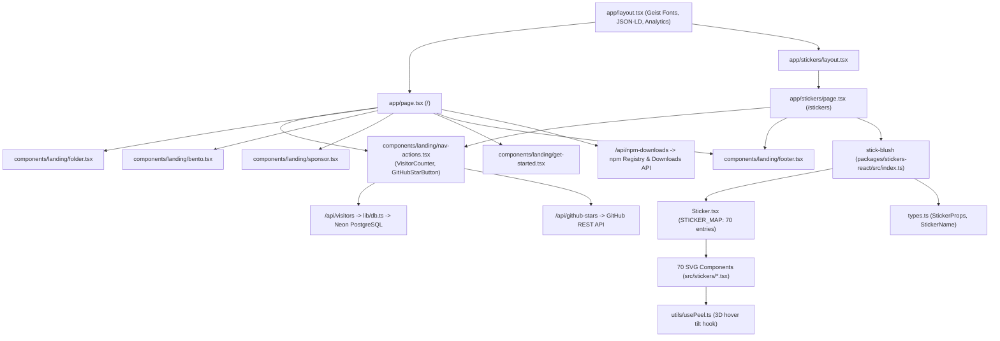
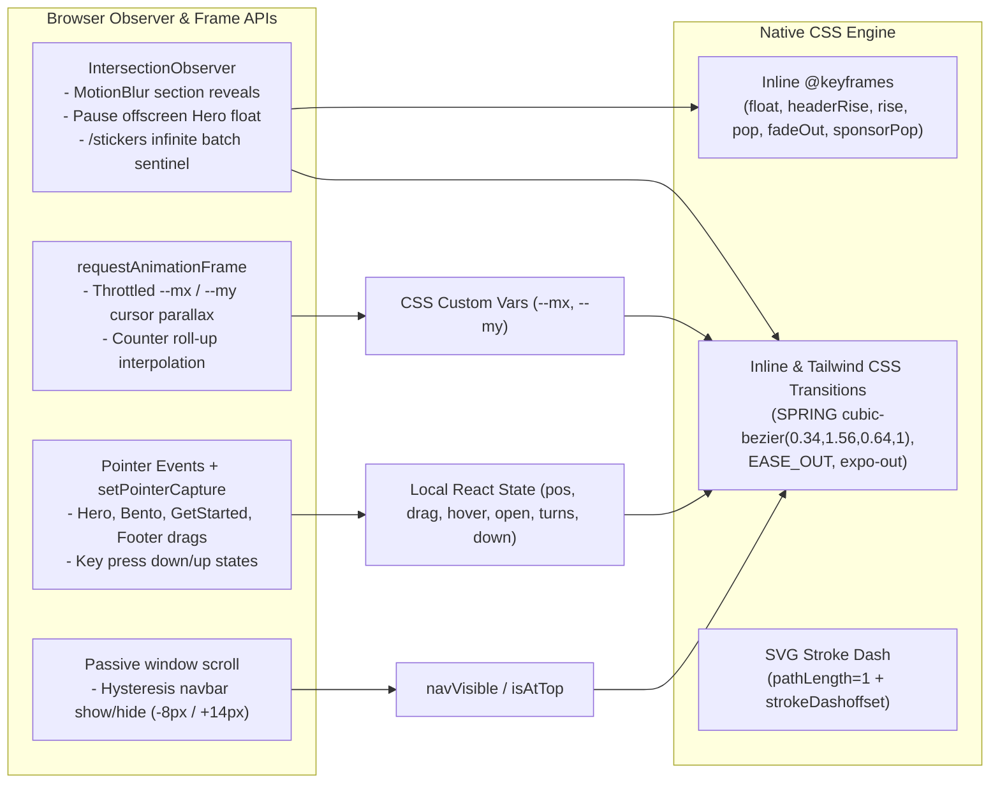
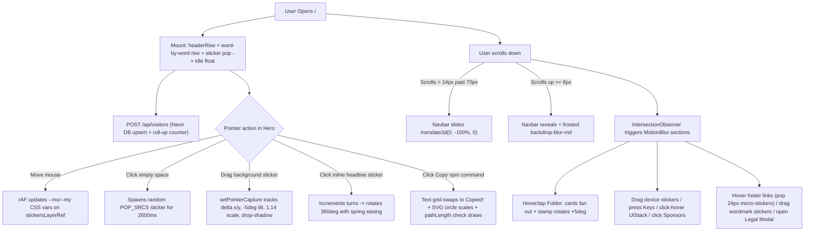
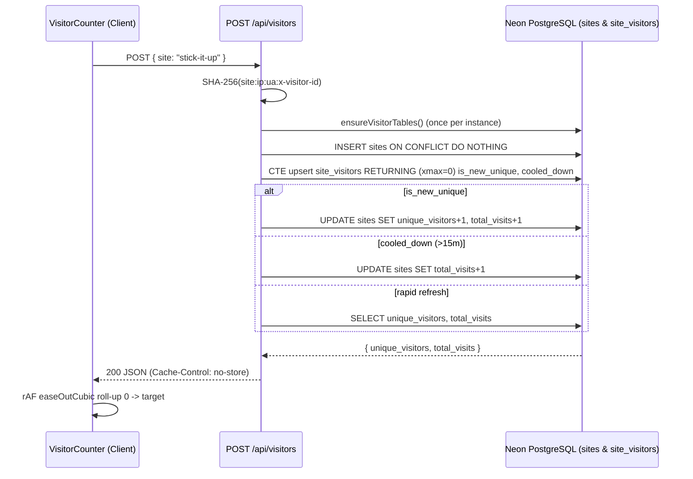

# Stick Blush — Complete Technical Audit & Architecture Documentation

> **Audit Scope & Verification Policy:** Every file path, symbol name, line number, CSS property, timing value, HEX color, SVG count, and runtime behavior documented below was directly inspected in the codebase at commit `7303962` (`Rebrand website to Stick Blush`). Where external constraints or future improvements are suggested, they are explicitly labeled as **Recommendations** or **Technical Debt**.

---

## Executive Summary

**Stick Blush** (website brand: **Stick it up** / **Stick It Up**, publishable npm package: **`stick-blush`**, repository: `Adhithyan411/Sticky`) is a Next.js App Router showcase application and React SVG sticker component library co-located in an npm workspace monorepo.

### Key Architectural Highlights
- **Zero Third-Party Animation Libraries:** The application does **not** use Framer Motion, Motion, GSAP, Lottie, Lenis, React Spring, or Canvas/WebGL runtime loops. Every entrance, spring bounce, card fan-out, parallax tilt, drag-and-drop interaction, keycap press, and SVG checkmark draw is engineered from native CSS `@keyframes`, CSS transitions with custom `cubic-bezier` curves, React `useState`/`useEffect`/`useRef`, Pointer Events (`setPointerCapture`), `IntersectionObserver`, and `requestAnimationFrame`.
- **Two-Layer Sticker Rendering Model:**
  1. **Marketing Landing Page (`/`)**: Renders 63 static SVG files from `public/stickers/` via standard `` tags wrapped in custom interactive shells (cursor parallax, click-to-stick pops, pointer drag, folder card fans, tactile keycaps).
  2. **Catalog & Published Library (`/stickers` & `packages/stickers-react`)**: Renders **70** standalone TypeScript/SVG React components (`64` cataloged on `/stickers`) compiled into ESM, CommonJS, and `.d.ts` bundles via `tsup`, with `useId()`-scoped SVG `<defs>` and an optional `peel` 3D tilt hover hook (`usePeel`).
- **Stateful Micro-Backend:** Three Next.js App Router API routes power a Neon PostgreSQL unique visitor counter (preserving the `"stick-it-up"` `site_name` key for DB continuity), an npm download aggregator with 365-day window chunking, and a cached GitHub star counter.

### Most Important Files to Understand First
1. [`package.json`](file:///Users/adhithyan/Documents/anti-gravity%20new%20folder/package.json) — Monorepo workspaces, Next.js `16.4.3`, React `19.3.0`, Tailwind CSS v4, and `stick-blush` workspace linkage.
2. [`app/page.tsx`](file:///Users/adhithyan/Documents/anti-gravity%20new%20folder/app/page.tsx) — Landing page composition, CSS `@keyframes`, smart scroll navbar, hero cursor parallax, click-to-stick pops, draggable hero stickers, and spin-on-click inline stickers.
3. [`components/landing/folder.tsx`](file:///Users/adhithyan/Documents/anti-gravity%20new%20folder/components/landing/folder.tsx) & [`components/landing/bento.tsx`](file:///Users/adhithyan/Documents/anti-gravity%20new%20folder/components/landing/bento.tsx) — `useInView`/`MotionBlur` reveal system, `cqw`-scaled skeuomorphic folders, stacked glass notification deck (`UiStack`), tactile keycaps (`Key`), and draggable card decals.
4. [`packages/stickers-react/src/components/Sticker.tsx`](file:///Users/adhithyan/Documents/anti-gravity%20new%20folder/packages/stickers-react/src/components/Sticker.tsx) & [`packages/stickers-react/src/utils/usePeel.ts`](file:///Users/adhithyan/Documents/anti-gravity%20new%20folder/packages/stickers-react/src/utils/usePeel.ts) — Dynamic `<Sticker name="..." />` registry (`STICKER_MAP`) and 3D vinyl `perspective(600px)` hover peel engine.
5. [`app/stickers/page.tsx`](file:///Users/adhithyan/Documents/anti-gravity%20new%20folder/app/stickers/page.tsx) — Full catalog search/filter (`useDeferredValue`), `BATCH_SIZE = 100` infinite scroll, interactive usage guide, and inspector modal with live preview + SVG serializer download.
6. [`lib/db.ts`](file:///Users/adhithyan/Documents/anti-gravity%20new%20folder/lib/db.ts) & [`app/api/visitors/route.ts`](file:///Users/adhithyan/Documents/anti-gravity%20new%20folder/app/api/visitors/route.ts) — Serverless Neon Postgres schema bootstrapper and SHA-256 visitor deduplication logic.

---

## High-Level Architecture Diagrams

### Component Dependency Map



### Animation Architecture Overview



### User Interaction Flow



---

## 1. Project Architecture

### Stack & Runtime Versions
Verified from [`package.json`](file:///Users/adhithyan/Documents/anti-gravity%20new%20folder/package.json):
- **Framework:** `next` `16.4.3` (App Router with `cacheComponents: true` and `partialPrefetching: true` enabled in [`next.config.ts`](file:///Users/adhithyan/Documents/anti-gravity%20new%20folder/next.config.ts#L9-L10))
- **UI Runtime:** `react` `19.3.0`, `react-dom` `19.3.0`
- **Language:** TypeScript `^5` (`strict: true`)
- **Styling:** Tailwind CSS v4 (`tailwindcss: ^4`, `@tailwindcss/postcss: ^4.3.5`, `@tailwindcss/turbopack: ^4`)
- **Library Bundler:** `tsup` `^9.0.0` (workspace dependency)
- **Database Driver:** `@neondatabase/serverless` `^1.2.0`
- **Icons / Telemetry / Experimental Configs:** `lucide-react` `^1.66.0`, `react-icons` `^5.7.0`, `@vercel/analytics` `^2.0.1`, plus `shaders` `^4.0.6` configured in [`shaders.config.ts`](file:///Users/adhithyan/Documents/anti-gravity%20new%20folder/shaders.config.ts) (note: no active route imports from `components/shaders`).

### Next.js & TypeScript Architecture
- **App Router Separation:**
  - [`app/layout.tsx`](file:///Users/adhithyan/Documents/anti-gravity%20new%20folder/app/layout.tsx) is a Server Component defining `metadata`, Schema.org `jsonLd` (`WebSite` + `SoftwareApplication`), Google Fonts (`Geist`, `Geist_Mono` via `next/font/google`, plus external `<link>` fonts), `<Analytics />`, and `scroll-smooth` on `<html>`.
  - [`app/page.tsx`](file:///Users/adhithyan/Documents/anti-gravity%20new%20folder/app/page.tsx) and [`app/stickers/page.tsx`](file:///Users/adhithyan/Documents/anti-gravity%20new%20folder/app/stickers/page.tsx) are `"use client"` page modules because both orchestrate interactive pointer tracking, scroll listeners, and client state.
  - [`app/stickers/layout.tsx`](file:///Users/adhithyan/Documents/anti-gravity%20new%20folder/app/stickers/layout.tsx) provides route-scoped SEO metadata for `/stickers` cleanly around the client page.
  - [`app/sitemap.ts`](file:///Users/adhithyan/Documents/anti-gravity%20new%20folder/app/sitemap.ts) and [`app/robots.ts`](file:///Users/adhithyan/Documents/anti-gravity%20new%20folder/app/robots.ts) dynamically resolve `baseUrl` from `NEXT_PUBLIC_SITE_URL`, `VERCEL_PROJECT_PRODUCTION_URL`, `VERCEL_URL`, or fallback `"https://stickitupp.vercel.app"`.
- **Monorepo TypeScript Wiring ([`tsconfig.json`](file:///Users/adhithyan/Documents/anti-gravity%20new%20folder/tsconfig.json#L21-L25)):**
  - Root path aliases map `"@/*"` to `"./*"`, `"stick-blush"` directly to `"./packages/stickers-react/src/index.ts"`, and `"stick-blush/*"` to `"./packages/stickers-react/src/*"`.
  - [`next.config.ts`](file:///Users/adhithyan/Documents/anti-gravity%20new%20folder/next.config.ts#L3-L4) configures `transpilePackages: ["stick-blush"]` alongside HTTP security and 1-year immutable asset cache headers (`public, max-age=31536000, immutable`) for `/stickers/:path*` and static image extensions.
  - Root [`package.json`](file:///Users/adhithyan/Documents/anti-gravity%20new%20folder/package.json#L6-L13) defines `"workspaces": ["packages/*"]`, `"stick-blush": "^0.1.0"`, and `"build": "npm run build:package && next build"`. Thus the website resolves `stick-blush` cleanly both in TypeScript dev/IDE via `paths` and in npm via workspace symlink.

### Directory Tree & Purpose

```text
.
├── .env.example                       # Documents DATABASE_URL env var format
├── LICENSE / README.md                # Root MIT license (Adhithyan S) & project docs
├── next.config.ts                     # Next.js config: transpilePackages, cacheComponents, security/cache headers
├── package.json / package-lock.json   # Root workspace manifest & lockfile
├── postcss.config.mjs                 # Tailwind v4 PostCSS plugin (@tailwindcss/postcss)
├── shaders.config.ts / shaders.lock.json # Connected Shaders registry metadata (unused at runtime)
├── tsconfig.json                      # Root TS config + stick-blush path aliases
├── eslint.config.mjs                  # ESLint 9 flat config (core-web-vitals + typescript)
├── lib/
│   └── db.ts                          # Neon serverless Postgres helper + ensureVisitorTables() DDL
├── app/
│   ├── globals.css                    # Tailwind v4 import + @theme inline font/color tokens
│   ├── layout.tsx                     # Root HTML shell, fonts, SEO metadata, JSON-LD, Vercel Analytics
│   ├── page.tsx                       # Landing page (/) + inline keyframes + hero/nav/download counter
│   ├── robots.ts / sitemap.ts         # Dynamic SEO crawler rules and XML sitemap
│   ├── api/
│   │   ├── github-stars/route.ts      # GET cached GitHub stargazer count
│   │   ├── npm-downloads/route.ts     # GET lifetime chunked npm download count for stick-blush
│   │   └── visitors/route.ts          # GET/POST/OPTIONS Neon DB & memory-fallback unique visitor counter
│   └── stickers/
│       ├── layout.tsx                 # Route metadata for /stickers
│       └── page.tsx                   # Sticker catalog (64 entries), search/filter, docs, inspector modal
├── components/landing/
│   ├── nav-actions.tsx                # Shared VisitorCounter, NpmDownloadsBadge, GitHubStarButton
│   ├── hero-video-background.tsx      # Full-bleed looping koi pond hero video backdrop + poster + fade
│   ├── folder.tsx                     # Section 3: Skeuomorphic folder cards with hover/tap card fan-out
│   ├── bento.tsx                      # Section 4: 4-card interactive Bento grid (Phone, Laptop, Keys, UiStack)
│   ├── sponsor.tsx                    # Section 5: Sponsors heading, spin cat, GitHub/Coffee/X tiles + Tooltips
│   ├── get-started.tsx                # Section 6: Bottom CTA card with 4 draggable corner stickers
│   └── footer.tsx                     # Section 7: Sky-gradient footer, sticker-hover links, wordmark, legal modal
├── packages/stickers-react/           # Publishable npm package ("stick-blush" v0.1.0)
│   ├── package.json / tsconfig.json / tsup.config.ts / README.md / LICENSE
│   └── src/
│       ├── index.ts                   # Public barrel exporting types, Sticker, STICKER_MAP, and 70 components
│       ├── types.ts                   # StickerProps & StickerName union (70 literal names)
│       ├── components/Sticker.tsx     # Dynamic <Sticker name="..." /> lookup table
│       ├── utils/usePeel.ts           # 3D perspective vinyl hover peel hook
│       └── stickers/*.tsx             # 70 pure-React SVG components (38 with useId(), 32 flat/pixel SVGs)
└── public/
    ├── og-image.png / og-image.webp   # Social preview banners
    ├── landing/stick-it-up-footer.png # Footer image asset
    ├── videos/
    │   ├── homepage-koi-pond.mp4      # Optimized 1080p 30fps looping hero background video (6.8 MB)
    │   └── homepage-koi-pond-poster.jpg # Immediate & reduced-motion poster fallback frame (244 KB)
    └── stickers/*.svg                 # 63 raw SVG files (62 sticker SVGs + logo.svg)
```

---

## 2. Complete Landing Page Breakdown

The landing route ([`/` -> `app/page.tsx`](file:///Users/adhithyan/Documents/anti-gravity%20new%20folder/app/page.tsx)) renders inside `<main className="relative min-h-screen w-full overflow-x-clip bg-white">` with inline `<style>` keyframes at the top of `<main>`. Sections render in the following strict vertical order:

### 1. Fixed Smart Navigation Bar (`app/page.tsx:397-471`)
- **Layout:** `fixed top-0 left-0 right-0 z-50 w-full px-4 py-2`, inner `<nav>` (`mx-auto flex h-14 max-w-6xl items-center justify-between rounded-2xl`).
- **Background & Visual Effects:** At top (`isAtTop`: `window.scrollY <= 20`), `bg-transparent border-b border-transparent shadow-none`. Scrolled: `backdrop-blur-md bg-white/85 border-b border-zinc-200/70 shadow-[0_2px_8px_-2px_rgba(0,0,0,0.05),0_1px_2px_rgba(0,0,0,0.02)]`.
- **Typography & Colors:** Adaptive by `isAtTop` — over the koi pond backdrop (`isAtTop === true`), brand text uses `text-white [text-shadow:0_1px_2px_rgba(0,0,0,0.4)]` and nav links use `text-white/90 hover:bg-white/15 hover:text-white`; once scrolled (`!isAtTop`), transitions smoothly back to `text-zinc-900` and `text-zinc-600 hover:bg-zinc-100 hover:text-zinc-900`.
- **Assets:** [`/stickers/logo.svg`](file:///Users/adhithyan/Documents/anti-gravity%20new%20folder/public/stickers/logo.svg) (`h-9 w-9 rounded-lg`, with subtle `ring-1 ring-white/25 shadow-xs` when `isAtTop`).
- **Responsive Behavior:** Center `<ul>` links (`Stickers`, `Docs`, `npm`) use `hidden md:flex`. Right action group (`VisitorCounter`, `GitHubStarButton`) compacts padding/fonts below `sm` and hides `"visitors"` label on narrow mobile screens (`hidden sm:inline`).
- **Interactions & Animations:** Mounts with `headerRise` (`700ms`, then cleared at `750ms` via `headerMounted`). Scroll hysteresis hides (`translate3d(0, -100%, 0)`) or reveals (`translate3d(0, 0, 0)`) the bar in `260ms`. Logo rotates `-6deg` and scales `1.10` on hover.

### 2. Full-Width Interactive Hero Canvas & Koi Pond Video (`app/page.tsx:474-695`, `hero-video-background.tsx`)
- **Layout Structure:** Full-width interactive wrapper `div` (`ref={heroRef}`, `relative min-h-[600px] w-full overflow-hidden sm:min-h-[680px]`) housing four stacked visual planes:
  1. **Video Backdrop Plane (`z-0`, `HeroVideoBackground`):** Static `homepage-koi-pond-poster.jpg` `` + single muted inline looping `<video src="/videos/homepage-koi-pond.mp4" />`, both subtly softened with `blur-[2.5px] scale-[1.02]`, topped by emerald-dark contrast scrims (`bg-[#071f19]/30` + radial depth vignette + top navbar edge gradient) and a compact bottom linear white fade (`h-10 sm:h-12`) transitioning seamlessly into `Folder`.
  2. **Click-to-Stick Pop Plane (`z-10`):** Renders ephemeral 56px (`w-14`) random SVGs from `POP_SRCS` (12 assets) centered on click coordinates `(e.clientX - rect.left - 28, e.clientY - rect.top - 28)`, capped to the latest 8 (`[...p.slice(-7), pop]`) and removed after `2600ms`.
  3. **Foreground Hero Content (`section`, `z-20`, `mx-auto max-w-4xl px-6 pt-32 pb-28 text-center sm:pt-36 md:pt-40 md:pb-32`):**
     - **Headline (`<h1>`):** `text-4xl sm:text-6xl lg:text-7xl font-normal leading-[1.1] tracking-tight text-white [text-shadow:0_2px_20px_rgba(4,24,19,0.5)]`, tokenized into `15` items in `HERO` (`12` text words + `3` inline `<HeroSticker>` images: `Curious%20blue%20globe.svg`, `Flame.svg`, `Peace-hand.svg`).
     - **Primary CTAs (`mt-14 flex flex-wrap justify-center gap-4`):**
       - Frosted light button: `npm i stick-blush@latest` (`backdrop-blur-md`, `border-white/75`) with clipboard copy morph (`Copy icon -> emerald check badge`).
       - Primary dark button: `Explore stickers` linking to `/stickers` (`from-zinc-900/95 to-zinc-950`, `border-white/20 backdrop-blur-md`) with angled arrow hover nudge.
     - **`TotalDownloadsCounter` (`mt-14`):** `80px × 80px` (`h-20 w-20`) `Component-66.svg` badge linking to `https://www.npmjs.com/package/stick-blush` (`hover:scale-110 hover:-rotate-3 active:scale-95`).
  4. **Floating Stickers Plane (`z-30`, `inset-0`, `pointer-events-none`):** 6 `DraggableSticker` instances positioned via percentage offsets (`blueberry.svg`, `face.svg`, `star.svg`, `flower.svg`, `cat.svg`, `Sparkles.svg`). Mobile shows top-left `blueberry.svg` and top-right `flower.svg`; the other 4 use `hidden sm:block`.

### 3. Folder Showcase Section (`components/landing/folder.tsx`)
- **Component & Path:** `FolderShowcase` in [`components/landing/folder.tsx`](file:///Users/adhithyan/Documents/anti-gravity%20new%20folder/components/landing/folder.tsx#L514-L663).
- **Layout:** `<section id="stickers" className="relative z-10 mx-4 mb-10 rounded-[40px] px-4 py-20 sm:px-8">`, inner `max-w-6xl`, header (`max-w-2xl mb-16`), and 2-column responsive grid (`grid-cols-1 gap-14 md:grid-cols-2 md:gap-8 lg:gap-20`).
- **Proportional Scaling System:** Each `<Folder>` button sets `containerType: "inline-size"` and `fontSize: "1.78cqw"` (`UNIT`), with `aspectRatio: "1.2 / 1"`. Every child dimension (`em` radii, bevel borders, shadows, mockups, avatars, stamp) scales proportionally with the folder width across viewports.
- **Visual Craft & Assets:** Back folder flap + tab (`#dcdce0 -> #ececef` & `#f4f4f6 -> #e2e2e6`), 3 layered UI mockup cards (`WebMock` / `PhoneMock` or custom `WEB_SHOTS`/`APP_SHOTS` slots), frosted white front panel (`#ffffff -> #f6f6f7 -> #ececee`) overlaid with CSS dot-grain (`GRAIN`, `opacity: 0.06`), overlapping circular pastel sticker avatars (`blueberry.svg`, `star.svg`, `Flame.svg`, `cat.svg`, `Curious%20blue%20globe.svg`), corner stamp (`pink-cat.svg`, `japan.svg`), and letterpress `<h3>` (`Landing pages`, `Mobile apps`).
- **Animations & Interactions:** Section reveals via `useInView` + `MotionBlur` (`delay: 0, 100, 200, 340`). Hover or click (`pinned` toggle) opens folders, lifting and fanning cards outward and rotating stamps `+5deg`. Avatar discs pop up on individual hover (`hover:scale-110 hover:-translate-y-1`).

### 4. Bento Showcase Grid (`components/landing/bento.tsx`)
- **Component & Path:** `Bento` in [`components/landing/bento.tsx`](file:///Users/adhithyan/Documents/anti-gravity%20new%20folder/components/landing/bento.tsx#L626-L869), wrapped in `<ShownCtx.Provider value={inView}>`.
- **Layout:** `<section id="showcase">`, `max-w-6xl`, 12-column CSS Grid on desktop (`grid-cols-1 gap-5 lg:grid-cols-12 lg:gap-6`):
  1. **Yellow Card (`lg:col-span-4 lg:row-span-2`, `min-h-[600px]`):** Gradient `#fff0a0 -> #ffd93d`. Contains checklist (`Check` pills), upward-sliding `Phone` hardware mockup (`translate3d(0, 96px, 0)` -> `0`) with iOS-style status bar, Dynamic Island, `"Good vibes only"`, gradient hero tile (`#FFFCF4 -> #FFE8B6`), `face.svg`, pastel square tiles, and **4 live draggable `Sticker` instances** (`Flame.svg`, `Sparkles.svg` inside screen + `cat.svg`, `Peace-hand.svg` overlapping frame). Hovering `<Phone>` lifts it `-mb-2.5 -> -translate-y-2.5`.
  2. **Red Card (`lg:col-span-4`, `min-h-[360px]`):** Gradient `#ff8a92 -> #f2535f`, white typography. Features a brushed-aluminum MacBook lid mockup (`#f4f6f9 -> #d6dbe2 -> #c5cbd4`) sliding in horizontally from `translate3d(110px, 0, 0)`, inline SVG `AppleLogo`, and **4 live draggable stickers** (`face.svg`, `star.svg`, `blueberry.svg`, `Sparkles.svg`).
  3. **Green Card (`lg:col-span-4`, `min-h-[360px]`):** Gradient `#e6f9c9 -> #b9ec8c`. Houses **3 interactive tactile mechanical `Key` buttons** (`Vector` -> `star.svg`, `Drag` -> `Peace-hand.svg`, `Pop` -> `red_cat.svg`) with `6px` 3D lip shadows that physically depress (`4px` travel) on press.
  4. **Blue Card (`lg:col-span-8`, `min-h-[340px]`):** Gradient `#e8f0ff -> #cfe0ff`. Split flex row: left column has developer copy + duplicate `npm i stick-blush@latest` copy-morph button; right column renders `<UiStack>` — 3 stacked `Glass` notification cards (`Flame.svg`, `red_cat.svg`, `Cosmiceye.svg`) topped with a floating `star.svg` that fan apart smoothly on hover or click.

### 5. Sponsors Section (`components/landing/sponsor.tsx`)
- **Component & Path:** `Sponsor` in [`components/landing/sponsor.tsx`](file:///Users/adhithyan/Documents/anti-gravity%20new%20folder/components/landing/sponsor.tsx#L323-L399).
- **Layout:** `max-w-6xl` section with inner `max-w-3xl sm:max-w-4xl`, clean white background (no card border/shadow).
- **Elements:**
  - Headline `"Sponsors."` paired with inline clickable [`/stickers/bad-cat.svg`](file:///Users/adhithyan/Documents/anti-gravity%20new%20folder/public/stickers/bad-cat.svg) (`rotate: ${starTurns * 360 - 8}deg`, `hover:rotate-[24deg] hover:scale-120`).
  - Narrative paragraph in `text-lg sm:text-xl md:text-[22px] text-zinc-600`.
  - Three square rounded (`rounded-[24px]`, `76px` mobile / `96px` `sm:h-24 w-24`) tiles popping via staggered `sponsorPop` keyframes (`delay = 420 + index * 60ms`), each with a mini circular corner badge and spring `<Tip>` tooltip:
    - `GitHubTile` (`#f4f4f5` fill, `#e4e4e7` border, GitHub mark, `+` badge, `"Sponsor on GitHub"`).
    - `CoffeeTile` (`#fef9c3` fill, `#fde047` border, mug SVG, amber `+` badge, `"Buy me a coffee"`).
    - `TwitterTile` (`#e4e4e7` fill, `#d4d4d8` border, X mark, black DM bubble badge, `"Follow on X"` / `"@Klyromotion"`).
  - Sign-off (`Thank you all. / Adhithyan.`) linking to `https://github.com/Adhithyan411`.

### 6. Bottom CTA Section (`components/landing/get-started.tsx`)
- **Component & Path:** `GetStarted` in [`components/landing/get-started.tsx`](file:///Users/adhithyan/Documents/anti-gravity%20new%20folder/components/landing/get-started.tsx#L137-L311).
- **Layout:** Centered `max-w-3xl` typography (`Ready to give your UI some personality?`) surrounded on `sm+` viewports by **4 corner `DraggableSticker` instances** (`star.svg`, `face.svg`, `pink-cat.svg`, `Peace-hand.svg`) and two action buttons: `"Get started with Stick It Up"` (`/stickers`) and the `npm i stick-blush@latest` copy-morph button.

### 7. Sky-Gradient Footer & Legal Modal (`components/landing/footer.tsx`)
- **Component & Path:** `Footer` in [`components/landing/footer.tsx`](file:///Users/adhithyan/Documents/anti-gravity%20new%20folder/components/landing/footer.tsx#L249-L591) (shared across both `/` and `/stickers`).
- **Background:** Vertical linear gradient `#ffffff -> #e6f2ff (26%) -> #8cc7fb (62%) -> #52aef9 (100%)` overlaid with masked CSS dot grain (`mask-t-from-10% to-100%`, `opacity: 0.06`).
- **Content Grid (`max-w-5xl`):** Left tagline (`"Stick it on. Ship it fun"`) with clickable spinning `InlineSticker` (`Peace-hand.svg`); right 4-column link grid (`Product`, `Contribute`, `Community`, `Legal`), where every link reveals a floating tilted `24px` sticker beside the text on hover.
- **Full-Bleed Wordmark & Stickers:** `containerType: "inline-size"` block rendering `"Stick it up"` at `21cqw` (`height: 14.5cqw`, `marginBottom: -2cqw`, `tracking-[-0.055em]`) cropped cleanly at the bottom edge and overlaid with **5 entrance-popping draggable stickers** (`star.svg`, `blueberry.svg`, `Flame.svg`, `flower.svg`, `cat.svg`).
- **Legal Dialog (`modalTab`):** Accessible modal (`role="dialog"`, `aria-modal="true"`, `Escape` close + `body.style.overflow = "hidden"` lock) with 3 tabs (`Privacy Policy`, `About the Design`, `MIT License`).

---

## 3. Animation Engineering (Exhaustive Breakdown)

### Library Verification
Inspection of `package.json`, `packages/stickers-react/package.json`, and all imports confirms:
- **Used:** Native CSS `@keyframes`, inline CSS `transition`, React `useState` / `useEffect` / `useRef`, `IntersectionObserver`, `requestAnimationFrame`, Pointer Events (`onPointerDown` + `setPointerCapture`), passive `window` scroll events, and SVG `pathLength={1}` + `strokeDashoffset`.
- **NOT Used:** Framer Motion / `motion`, GSAP, React Spring, Anime.js, Lenis, Canvas 2D, Lottie, or WebGL shader runtime loops.

Shared motion tokens duplicated cleanly across landing modules:
- `SPRING = "cubic-bezier(0.34, 1.56, 0.64, 1)"` (bouncy overshoot curve)
- `EASE_OUT = "cubic-bezier(0.2, 0.8, 0.2, 1)"` (crisp deceleration curve)
- Expo-out variant used on nav/cards/inspector: `"cubic-bezier(0.16, 1, 0.3, 1)"`

### Core Implementation Excerpts

**1. Hero `@keyframes` & `prefers-reduced-motion` (`app/page.tsx:368-394`):**

```css
@keyframes float {
  0%, 100% { transform: translateY(0); }
  50% { transform: translateY(-10px); }
}
@keyframes headerRise {
  from { opacity: 0; transform: translateY(-10px); filter: blur(6px); }
  to { opacity: 1; transform: translateY(0); filter: none; }
}
@keyframes rise {
  from { opacity: 0; transform: translateY(16px); filter: blur(6px); }
  to { opacity: 1; transform: translateY(0); filter: none; }
}
@keyframes pop {
  0% { transform: scale(0) rotate(-20deg); opacity: 0; }
  100% { transform: scale(1) rotate(0); opacity: 1; }
}
@keyframes fadeOut {
  to { opacity: 0; transform: scale(0.8); }
}
@media (prefers-reduced-motion: reduce) {
  *, *::before, *::after {
    animation: none !important;
    transition: none !important;
  }
}
```

**2. Hero 3-Layer Sticker Architecture & rAF Cursor Parallax (`app/page.tsx:95-135, 334-345`):**

```tsx
// Layer 1: responsive clamp + entrance pop + mouse parallax (--mx, --my)
<div
  className={`pointer-events-none absolute ${className}`}
  style={{
    width: `clamp(48px, ${size / 14.4}vw, ${size}px)`,
    translate: `calc(var(--mx, 0) * ${depth}px) calc(var(--my, 0) * ${depth}px)`,
    transition: "translate 400ms ease-out",
    animation: `pop 650ms ${SPRING} ${400 + delay * 120}ms both`,
  }}
>
  {/* Layer 2: idle float (paused while dragging OR off-screen via IntersectionObserver) */}
  <div
    data-float
    style={{
      animation: `float ${5 + delay}s ease-in-out ${delay * 0.6}s infinite`,
      animationPlayState: drag ? "paused" : "running",
    }}
  >
    {/* Layer 3: pointer drag, hover lift, tilt */}
    <div
      data-sticker
      onPointerDown={onDown}
      onPointerMove={onMove}
      onPointerUp={onUp}
      onPointerCancel={onUp}
      onPointerEnter={() => setHover(true)}
      onPointerLeave={() => setHover(false)}
      className="pointer-events-auto touch-none select-none"
      style={{
        translate: `${pos.x}px ${pos.y}px`,
        rotate: `${rotate + (drag ? -5 : hover ? 8 : 0)}deg`,
        scale: drag ? 1.14 : hover ? 1.06 : 1,
        cursor: drag ? "grabbing" : "grab",
        filter: drag
          ? "drop-shadow(0 18px 18px rgba(0,0,0,0.32))"
          : "drop-shadow(0 8px 16px rgba(0,0,0,0.22))",
        transition: `scale 450ms ${SPRING}, rotate 450ms ${SPRING}`,
      }}
    >
      
    </div>
  </div>
</div>
```

```ts
function onPointerMove(e: React.PointerEvent<HTMLElement>) {
  if (rafParallax.current !== null) return;
  const clientX = e.clientX;
  const clientY = e.clientY;
  rafParallax.current = requestAnimationFrame(() => {
    rafParallax.current = null;
    const el = stickersLayerRef.current;
    if (!el) return;
    el.style.setProperty("--mx", String((clientX / window.innerWidth - 0.5) * 2));
    el.style.setProperty("--my", String((clientY / window.innerHeight - 0.5) * 2));
  });
}
```

**3. Self-Drawing SVG Checkmark & Grid-Overlap Text Morph (`app/page.tsx:594-663`):**

```tsx
<circle
  cx="12"
  cy="12"
  r="11"
  className="fill-emerald-500"
  style={{
    transformOrigin: "center",
    transformBox: "fill-box",
    transform: copied ? "scale(1)" : "scale(0.4)",
    opacity: copied ? 1 : 0,
    transition: "transform 350ms cubic-bezier(0.34, 1.56, 0.64, 1), opacity 150ms ease-out",
  }}
/>
<path
  d="m7 12.5 3.2 3.2L17 8.8"
  pathLength={1}
  stroke="white"
  strokeWidth="2.6"
  strokeLinecap="round"
  strokeLinejoin="round"
  style={{
    strokeDasharray: 1,
    strokeDashoffset: copied ? 0 : 1,
    transition: copied ? "stroke-dashoffset 280ms ease-out 140ms" : "stroke-dashoffset 120ms ease-in",
  }}
/>
```

**4. `MotionBlur` Scroll Reveal With Post-Settle Layer Cleanup (`components/landing/folder.tsx:53-91`):**

```tsx
useEffect(() => {
  if (inView) {
    const t = setTimeout(() => setSettled(true), delay + 850);
    return () => clearTimeout(t);
  }
}, [inView, delay]);

return (
  <div
    className={className}
    style={{
      opacity: inView ? 1 : 0,
      transform: inView ? "translate3d(0, 0, 0)" : "translate3d(0, 24px, 0)",
      filter: settled ? "none" : inView ? "blur(0px)" : `blur(${blur}px)`,
      transition: settled
        ? "none"
        : `opacity 650ms ${EASE_OUT} ${delay}ms, transform 750ms ${EASE_OUT} ${delay}ms, filter 650ms ${EASE_OUT} ${delay}ms`,
      willChange: settled ? "auto" : "opacity, transform",
    }}
  >
    {children}
  </div>
);
```

**5. `usePeel` 3D Vinyl Perspective Hover Hook (`packages/stickers-react/src/utils/usePeel.ts:22-44`):**

```ts
const baseTransform = userStyle?.transform ? `${userStyle.transform} ` : "";
const transform = hovered
  ? `${baseTransform}perspective(600px) rotateX(10deg) rotateY(-10deg) translateY(-8px) scale(1.08)`
  : `${baseTransform}perspective(600px) rotateX(0deg) rotateY(0deg) translateY(0) scale(1)`;

const baseFilter = userStyle?.filter ? `${userStyle.filter} ` : "";
const filter = hovered
  ? `${baseFilter}drop-shadow(0 20px 25px rgba(0, 0, 0, 0.35))`
  : (userStyle?.filter || "drop-shadow(0 2px 4px rgba(0, 0, 0, 0.05))");
```

**6. Koi Pond Hero Video Backdrop (`components/landing/hero-video-background.tsx:72-112`):**

```tsx

<video
  ref={videoRef}
  src={VIDEO_SRC}
  poster={POSTER_SRC}
  autoPlay
  muted
  loop
  playsInline
  preload="metadata"
  controls={false}
  disablePictureInPicture
  disableRemotePlayback
  onLoadedData={() => setVideoReady(true)}
  onCanPlay={() => setVideoReady(true)}
  onError={() => setVideoReady(false)}
  className={`motion-reduce:hidden absolute inset-0 h-full w-full scale-[1.02] object-cover object-center blur-[2.5px] transition-opacity duration-500 ease-out ${
    videoReady ? "opacity-100" : "opacity-0"
  }`}
/>
<div className="absolute inset-0 bg-[#071f19]/30" />
<div className="absolute inset-0 bg-[radial-gradient(ellipse_78%_62%_at_50%_46%,rgba(6,26,22,0.42)_0%,rgba(6,26,22,0.14)_68%,transparent_100%)]" />
<div className="absolute inset-x-0 top-0 h-28 bg-gradient-to-b from-black/35 via-black/10 to-transparent" />
<div className="absolute inset-x-0 bottom-0 h-10 sm:h-12 bg-[linear-gradient(to_bottom,rgba(255,255,255,0)_0%,rgba(255,255,255,0.28)_55%,rgba(255,255,255,0.78)_85%,#ffffff_100%)]" />
```

---

### Animation 1: `headerRise` (Navbar Initial Entrance)
- **Component & File:** `<header>` in [`app/page.tsx:370-373, 404`](file:///Users/adhithyan/Documents/anti-gravity%20new%20folder/app/page.tsx#L370-L405) and [`app/stickers/page.tsx:1104-1107, 1131`](file:///Users/adhithyan/Documents/anti-gravity%20new%20folder/app/stickers/page.tsx#L1104-L1132).
- **Trigger:** Page load (`!headerMounted`, switched to `true` after `750ms`).
- **Initial -> Final State:** `opacity: 0; transform: translateY(-10px); filter: blur(6px)` -> `opacity: 1; transform: translateY(0); filter: none`.
- **Properties Animated:** `opacity`, `transform` (`translateY`), `filter` (`blur`).
- **Duration / Delay / Easing / Loop:** `700ms` / `0ms` / `cubic-bezier(0.2, 0.8, 0.2, 1)` / One-time (`both`).
- **Implementation:** Once `headerMounted` flips at `750ms`, inline `animation` becomes `undefined` so subsequent scroll hide/show `transform` transitions are never fought by a `forwards`-filled animation.
- **Customization:** Edit `-10px`/`blur(6px)` in `@keyframes headerRise`, `700ms` on `<header>`, and keep the `clearTimeout` cutoff in `useEffect` slightly above duration (`duration + 50ms`).

### Animation 2: Smart Scroll Navbar Slide & Surface Morph
- **Component & File:** `<header>` in [`app/page.tsx:255-305, 394-405`](file:///Users/adhithyan/Documents/anti-gravity%20new%20folder/app/page.tsx#L255-L405) and [`app/stickers/page.tsx:861-911, 1121-1132`](file:///Users/adhithyan/Documents/anti-gravity%20new%20folder/app/stickers/page.tsx#L861-L1132).
- **Trigger:** Window `scroll` (`{ passive: true }`).
- **Initial -> Final State:** Visible at `translate3d(0, 0, 0)`, `pointerEvents: "auto"`, transparent surface (or `bg-white/80` on `/stickers`). Hidden when scrolling down `>= 14px` past `y > 70`: `translate3d(0, -100%, 0)`, `pointerEvents: "none"`. Re-shown when scrolling up `<= -8px` or `y <= 20`.
- **Properties Animated:** `transform`, `background-color`, `border-color`, `box-shadow`.
- **Duration / Delay / Easing / Loop:** `transform 260ms cubic-bezier(0.16, 1, 0.3, 1)`, surface `200ms ease` / `0ms` / Event-driven.
- **Implementation:** Uses `scrollAcc` ref to accumulate unidirectional deltas and reset on direction reversals so trackpad micro-jitters never flicker the bar. Uses `willChange: "transform"`.
- **Customization:** Adjust thresholds `-8` (up intent), `14` (down intent), `70` (top lock zone), and `260ms` transition timing.

### Animation 3: `rise` (Staggered Hero Word & CTA Cascade)
- **Component & File:** Hero `<h1>` tokens, `<HeroSticker>`, CTA wrapper, `TotalDownloadsCounter` in [`app/page.tsx:146, 215, 374-377, 538-560`](file:///Users/adhithyan/Documents/anti-gravity%20new%20folder/app/page.tsx#L374-L560) and `/stickers` title/bar ([`app/stickers/page.tsx:1108-1111, 1210, 1221`](file:///Users/adhithyan/Documents/anti-gravity%20new%20folder/app/stickers/page.tsx#L1108-L1221)).
- **Trigger:** Page load.
- **Initial -> Final State:** `opacity: 0; transform: translateY(16px); filter: blur(6px)` -> `opacity: 1; transform: translateY(0); filter: none`.
- **Properties Animated:** `opacity`, `transform`, `filter`.
- **Duration / Delay / Easing / Loop:** `700ms` / Staggered: `80 + i * 55ms` for the 15 hero tokens (`80ms` to `850ms`), `1000ms` for CTA buttons, `1150ms` for npm badge (`80ms`/`240ms` on `/stickers`) / `cubic-bezier(0.2, 0.8, 0.2, 1)` / One-time (`both`).
- **Customization:** Modify step multiplier `55` or base `80` in [`app/page.tsx:540`](file:///Users/adhithyan/Documents/anti-gravity%20new%20folder/app/page.tsx#L540).

### Animation 4: `pop` (Sticker Entrance & Click-to-Stick Spawn)
- **Component & File:** Hero `DraggableSticker` ([`app/page.tsx:100`](file:///Users/adhithyan/Documents/anti-gravity%20new%20folder/app/page.tsx#L100)), Hero click `pops` ([`app/page.tsx:529`](file:///Users/adhithyan/Documents/anti-gravity%20new%20folder/app/page.tsx#L529)), keyframes [`app/page.tsx:378-381`](file:///Users/adhithyan/Documents/anti-gravity%20new%20folder/app/page.tsx#L378-L381).
- **Trigger:** Page load (background stickers) or Hero empty-space click (pop stickers).
- **Initial -> Final State:** `transform: scale(0) rotate(-20deg); opacity: 0` -> `transform: scale(1) rotate(0); opacity: 1`.
- **Properties Animated:** `transform` (`scale`, `rotate`), `opacity`.
- **Duration / Delay / Easing / Loop:** Background stickers: `650ms`, delay `400 + delay * 120ms` (`400ms`, `520ms`, `640ms`). Click pops: `500ms`, `0ms` delay / `SPRING` (`cubic-bezier(0.34, 1.56, 0.64, 1)`) / One-time (`both`).
- **Customization:** Change initial angle `-20deg`, bounce overshoot in `SPRING`, or stagger multiplier `120`.

### Animation 5: `fadeOut` (Ephemeral Click Sticker Exit)
- **Component & File:** Click `pops` in [`app/page.tsx:359-360, 382-384, 529`](file:///Users/adhithyan/Documents/anti-gravity%20new%20folder/app/page.tsx#L382-L530).
- **Trigger:** Automatic (`2100ms` after click spawn, unmounted from `pops` array at `2600ms`).
- **Initial -> Final State:** `opacity: 1; transform: scale(1)` -> `opacity: 0; transform: scale(0.8)`.
- **Properties Animated:** `opacity`, `transform` (`scale`).
- **Duration / Delay / Easing / Loop:** `400ms` / `2100ms` / `ease-in` / One-time (`forwards`).

### Animation 6: `float` (Viewport-Paused Hero Sticker Levitation)
- **Component & File:** Hero `DraggableSticker` Layer 2 (`[data-float]`) in [`app/page.tsx:104-109, 308-319, 366-369`](file:///Users/adhithyan/Documents/anti-gravity%20new%20folder/app/page.tsx#L104-L369).
- **Trigger:** Automatic continuous loop; dynamically paused when dragging (`animationPlayState: drag ? "paused" : "running"`) OR when `stickersLayerRef` leaves the viewport via `IntersectionObserver`.
- **Initial -> Intermediate -> Final State:** `0%: translateY(0)` -> `50%: translateY(-10px)` -> `100%: translateY(0)`.
- **Properties Animated:** `transform` (`translateY`).
- **Duration / Delay / Easing / Loop:** `${5 + delay}s` (`5s`, `6s`, `7s`) / `${delay * 0.6}s` (`0s`, `0.6s`, `1.2s`) / `ease-in-out` / `infinite`.
- **Customization:** Adjust `-10px` excursion in `@keyframes float` or cycle base `5s` per sticker.

### Animation 7: Hero Cursor Parallax (`--mx`, `--my`)
- **Component & File:** `onPointerMove` and Layer 1 of `DraggableSticker` in [`app/page.tsx:94-101, 331-342`](file:///Users/adhithyan/Documents/anti-gravity%20new%20folder/app/page.tsx#L94-L342).
- **Trigger:** Pointer movement over `heroRef`.
- **Initial -> Active State:** Normalized cursor coords `mx, my ∈ [-1, 1]` multiply each sticker's `depth` (`14px`–`28px`), driving `translate: calc(var(--mx, 0) * ${depth}px) calc(var(--my, 0) * ${depth}px)`.
- **Properties Animated:** CSS `translate` property.
- **Duration / Delay / Easing / Loop:** `400ms` / `0ms` / `ease-out` / Continuous while moving, throttled once per animation frame (`rafParallax` ref).
- **Why performant:** Updating CSS custom properties directly on `stickersLayerRef.current.style` avoids triggering React re-renders on the Hero tree during mouse motion.

### Animation 8: `HeroSticker` & Footer `InlineSticker` Spin-on-Click
- **Component & File:** `HeroSticker` ([`app/page.tsx:139-165`](file:///Users/adhithyan/Documents/anti-gravity%20new%20folder/app/page.tsx#L139-L165)) and `InlineSticker` ([`components/landing/footer.tsx:147-168`](file:///Users/adhithyan/Documents/anti-gravity%20new%20folder/components/landing/footer.tsx#L147-L168)).
- **Trigger:** Hover (`onPointerEnter`/`Leave`) and Click (`onClick={() => setTurns(t => t + 1)}`).
- **Initial -> Hover -> Click State:** Base `0deg`, `scale: 1` -> Hover `+14deg`, `scale: 1.1` (`1.12` in footer) -> Each click adds `+360deg` cumulatively.
- **Properties Animated:** CSS `rotate`, `scale`.
- **Duration / Delay / Easing / Loop:** `rotate 650ms SPRING`, `scale 300ms SPRING`.

### Animation 9: `MotionBlur` Section Reveals (`useInView`)
- **Component & File:** Duplicated locally in `folder.tsx:53-91`, `bento.tsx:68-106`, `sponsor.tsx:45-83`, `get-started.tsx:41-79`, `footer.tsx:48-86`.
- **Trigger:** `IntersectionObserver` (`disconnect()`s after first intersection). `folder.tsx` (`150ms`–`180ms`) and `bento.tsx` (`280ms`) also set `animateOnLoad = true` fallback timers so above/near-fold sections never stall invisible.
- **Initial -> Transition -> Settled State:**
  - Initial: `opacity: 0; transform: translate3d(0, 24px, 0); filter: blur(8px)`.
  - Active: `opacity: 1; transform: translate3d(0, 0, 0); filter: blur(0px)`.
  - Settled (`delay + 850ms` after `inView`): `filter: "none"; transition: "none"; willChange: "auto"` to tear down GPU layer allocations and filter compositing post-reveal.
- **Properties Animated:** `opacity`, `transform`, `filter`.
- **Duration / Delay / Easing:** `opacity 650ms EASE_OUT`, `transform 750ms EASE_OUT`, `filter 650ms EASE_OUT` at staggered delays (`0`–`450ms`).

### Animation 10: Device Showcase Entrances (`Phone` & MacBook Lid)
- **Component & File:** Yellow Phone wrapper ([`components/landing/bento.tsx:689-699`](file:///Users/adhithyan/Documents/anti-gravity%20new%20folder/components/landing/bento.tsx#L689-L699)) and Red Laptop lid ([`components/landing/bento.tsx:712-725`](file:///Users/adhithyan/Documents/anti-gravity%20new%20folder/components/landing/bento.tsx#L712-L725)).
- **Trigger:** Section `inView` boolean from `Bento`.
- **Initial -> Final State:**
  - Phone: `translate3d(0, 96px, 0); opacity: 0; filter: blur(8px)` -> `translate3d(0, 0, 0); opacity: 1; filter: blur(0px)`.
  - Laptop: `translate3d(110px, 0, 0); opacity: 0; filter: blur(8px)` -> `translate3d(0, 0, 0); opacity: 1; filter: blur(0px)`.
- **Duration / Delay / Easing:** `transform 900ms cubic-bezier(0.16, 1, 0.3, 1)`, `opacity 800ms EASE_OUT`, `filter 700ms EASE_OUT`; delays `220ms` (Phone) and `280ms` (Laptop).

### Animation 11: Folder Open Card Fan-Out & Stamp Tilt
- **Component & File:** `Folder` in [`components/landing/folder.tsx:353-510`](file:///Users/adhithyan/Documents/anti-gravity%20new%20folder/components/landing/folder.tsx#L353-L510).
- **Trigger:** Hover (`onPointerEnter`/`Leave`) or tap/click pin (`onClick={() => setPinned(p => !p)}`).
- **States:** `open = hover || pinned`.
  - Cards: `translate` shifts vertically from `c.lift` to `c.lift - 5` (`-5em` lift) and `rotate` multiplies outward by `1.6×` (`c.rot + c.rot * 0.6`).
  - Stamp sticker: `rotate` increases `+5deg` (`stampRot` -> `stampRot + 5`).
  - Ground shadow: `scale` contracts horizontally `1 1` -> `0.94 1` (`300ms ease-out`).
- **Duration / Delay / Easing:** Cards: `600ms SPRING`, staggered `i * 40ms` (`0ms`, `40ms`, `80ms`). Stamp: `600ms SPRING`.

### Animation 12: Tactile Mechanical Sticker Keys
- **Component & File:** `Key` in [`components/landing/bento.tsx:288-331`](file:///Users/adhithyan/Documents/anti-gravity%20new%20folder/components/landing/bento.tsx#L288-L331).
- **Trigger:** `onPointerEnter`/`Leave` and `onPointerDown`/`Up`.
- **States:**
  - Keycap base: rests at `translate: 0 0` with `boxShadow: "inset 0 1px 0 #fff, 0 6px 0 #a9d77a"`; pressed (`down`) drops `translate: 0 4px` with compressed `1px` lip and inner depression shadow (`translate 160ms SPRING, box-shadow 160ms ease-out`).
  - Top sticker image: hover tilts `+8deg` and scales `1.08`; press tilts `-4deg` and scales `0.94` (`rotate 400ms SPRING, scale 300ms SPRING`).

### Animation 13: Stacked UI Card Fan (`UiStack`)
- **Component & File:** `UiStack` in [`components/landing/bento.tsx:504-620`](file:///Users/adhithyan/Documents/anti-gravity%20new%20folder/components/landing/bento.tsx#L504-L620).
- **Trigger:** Hover (`onMouseEnter`/`Leave`) or click (`onClick` toggle).
- **Initial -> Open States:**
  - Card 0 (back): `y: 12px, scale: 0.90` -> `y: 0px, scale: 0.88`.
  - Card 1 (middle): `y: 50px, scale: 0.955` -> `y: 86px, scale: 0.95`.
  - Card 2 (front): `y: 88px, scale: 1` -> `y: 172px, scale: 1`.
  - Floating top-right star (`star.svg`): `y: 12px -> 0px` at fixed `rotate(14deg)`.
- **Duration / Delay / Easing:** First `1500ms` after section reveal uses `550ms SPRING` with `i * 45ms` stagger; once `ready = true`, switches cleanly to snappy `420ms cubic-bezier(0.16, 1, 0.3, 1)` with `0ms` delay.

### Animation 14: Copy-to-Clipboard Morph & Self-Drawing SVG Checkmark
- **Component & File:** [`app/page.tsx:563-648`](file:///Users/adhithyan/Documents/anti-gravity%20new%20folder/app/page.tsx#L563-L648), [`components/landing/bento.tsx:768-857`](file:///Users/adhithyan/Documents/anti-gravity%20new%20folder/components/landing/bento.tsx#L768-L857), [`components/landing/get-started.tsx:217-304`](file:///Users/adhithyan/Documents/anti-gravity%20new%20folder/components/landing/get-started.tsx#L217-L304), plus simpler text-swap variant in [`app/stickers/page.tsx:1224-1261`](file:///Users/adhithyan/Documents/anti-gravity%20new%20folder/app/stickers/page.tsx#L1224-L1261).
- **Trigger:** Click (`copied` stays `true` for `1500ms` on landing, `1800ms` on `/stickers`).
- **Four Synchronized Sub-Animations:**
  1. **Grid-cell Text Swap:** Command text leaves upward (`-translate-y-1 opacity-0 blur-[2px]`) while `"Copied!"` rises into the same CSS Grid cell (`translate-y-1 opacity-0 blur-[2px]` -> `translate-y-0 opacity-100 blur-0 delay-75`, `300ms ease-out`) so button width never shifts.
  2. **Copy Icon Exit:** `scale-100 opacity-100` -> `scale-75 opacity-0` (`200ms ease-out`).
  3. **Emerald Badge Pop:** `<circle r="11">` scales `0.4` -> `1` (`350ms SPRING`) and fades `0` -> `1` (`150ms ease-out`) with `transformBox: "fill-box"`.
  4. **Checkmark Stroke Draw:** `<path pathLength={1} />` animates `strokeDashoffset` from `1` -> `0` (`280ms ease-out 140ms`, reverses `120ms ease-in`).

### Animation 15: `sponsorPop`, Tile Hover, Badge Pop & Tooltip `<Tip>`
- **Component & File:** [`components/landing/sponsor.tsx:88-379`](file:///Users/adhithyan/Documents/anti-gravity%20new%20folder/components/landing/sponsor.tsx#L88-L379).
- **Triggers:** `inView` (tile entrance) + `group-hover` / `focus-visible` (tile interactions).
- **Implementations:**
  - `sponsorPop`: `0%: opacity 0; translateY(14px) scale(0.6) rotate(-6deg)` -> `100%: opacity 1; translateY(0) scale(1) rotate(0deg)`, `600ms SPRING`, delay `420 + index * 60ms` (`420ms`, `480ms`, `540ms`).
  - Tile Inner Card: translates `-translate-y-1.5` (`350ms SPRING`) while outer `<a>` stays static to prevent pointer-edge hover jitter; active click presses `scale-95`; center icon scales `1.10` and tilts `-6deg` (GitHub/X) or `+8deg` (Coffee); corner badge scales `1.25`.
  - `<Tip>` Tooltip: `scale-75 opacity-0` -> `scale-100 opacity-100` with `transformOrigin: "50% 100%"` (`transform 260ms SPRING, opacity 160ms ease-out`).

### Animation 16: Footer Hover Stickers & Wordmark Sticker Entrances
- **Component & File:** [`components/landing/footer.tsx:195-242, 311-385, 416-420`](file:///Users/adhithyan/Documents/anti-gravity%20new%20folder/components/landing/footer.tsx#L195-L420).
- **Footer Link Micro-Stickers:** On `group-hover` of any footer link/button, an adjacent `24px × 24px` tilted `` springs from `opacity-0 scale-0` to `opacity-100 scale-100` (`200ms SPRING`).
- **Wordmark `DraggableSticker` Layer 1 Pop:** Transitioned via `inView`: `scale(0) rotate(-20deg); opacity: 0` -> `scale(1) rotate(0deg); opacity: 1` (`transform 650ms SPRING`, `opacity 300ms ease-out`) at delays `640ms`, `720ms`, `800ms`, `880ms`, `960ms`.

### Animation 17: Live Number Roll-Up (`VisitorCounter` & `TotalDownloadsCounter`)
- **Component & File:** [`components/landing/nav-actions.tsx:30-44`](file:///Users/adhithyan/Documents/anti-gravity%20new%20folder/components/landing/nav-actions.tsx#L30-L44) and [`app/page.tsx:183-198`](file:///Users/adhithyan/Documents/anti-gravity%20new%20folder/app/page.tsx#L183-L198).
- **Trigger:** Completion of API `fetch`.
- **Math & Timing:** Cubic ease-out `1 - Math.pow(1 - progress, 3)` inside a `requestAnimationFrame` loop from `0` to `target`. Duration: `Math.min(1000, Math.max(450, target * 120))` ms for `VisitorCounter`; `1200ms` fixed for `TotalDownloadsCounter` (though `count` is currently unused in JSX).

### Animation 18: 3D Vinyl Hover Peel (`usePeel`)
- **Component & File:** [`packages/stickers-react/src/utils/usePeel.ts:5-45`](file:///Users/adhithyan/Documents/anti-gravity%20new%20folder/packages/stickers-react/src/utils/usePeel.ts#L5-L45), used by all 70 stickers in `/stickers` Docs preview and Inspector modal.
- **Trigger:** `onMouseEnter` / `onMouseLeave` when `peel={true}`.
- **Initial -> Hover State:**
  - Resting: `perspective(600px) rotateX(0deg) rotateY(0deg) translateY(0) scale(1)` + `drop-shadow(0 2px 4px rgba(0, 0, 0, 0.05))`.
  - Hover: `perspective(600px) rotateX(10deg) rotateY(-10deg) translateY(-8px) scale(1.08)` + `drop-shadow(0 20px 25px rgba(0, 0, 0, 0.35))`.
- **Duration / Easing:** `transform 350ms cubic-bezier(0.34, 1.56, 0.64, 1), filter 350ms cubic-bezier(0.34, 1.56, 0.64, 1)`.

---

## 4. Scroll-Based Animations

There is **no** scroll-scrubbed keyframe timeline (`animation-timeline: scroll()`), ScrollTrigger, or continuous `scrollY`-to-parallax transform binding in the project. Scroll is handled through four clean, discrete patterns:

1. **Hysteresis Smart Navbar (`app/page.tsx:266-305`, `app/stickers/page.tsx:872-911`):**
   - Attaches a passive listener (`{ passive: true }`) reading `window.scrollY`.
   - Near top (`y <= 20`): forces `isAtTop = true` and `navVisible = true`.
   - Beyond `20px`: accumulates directional delta in `scrollAcc.current`, resetting immediately whenever scroll direction reverses.
   - Hides header when scrolling down `>= 14px` and `y > 70`; reveals immediately on `<= -8px` upward scroll.
2. **Intersection-Observed Viewport Reveals (`useInView` + `MotionBlur`):**
   - Each landing section (`folder.tsx`, `bento.tsx`, `sponsor.tsx`, `get-started.tsx`, `footer.tsx`) attaches an `IntersectionObserver` with generous positive `rootMargin` (`"250px 0px 100px 0px"` or `"150px 0px 50px 0px"`) and low `threshold` (`0.05` or `0.08`) so sections begin fading/unblurring before entering the viewport center, then `disconnect()`s permanently.
   - `folder.tsx` and `bento.tsx` also configure `animateOnLoad = true` fallback timers (`150ms` and `280ms`) for near-fold sections.
3. **Offscreen Idle-Loop Power Saving (`app/page.tsx:308-319`):**
   - An `IntersectionObserver` watches `stickersLayerRef`. When the hero stickers scroll out of view (`!entry.isIntersecting`), it toggles `.style.animationPlayState = "paused"` on the container and every `[data-float]` node, resuming `"running"` when scrolled back.
4. **Catalog Infinite Batch Loader & Smooth Hash Anchors (`app/stickers/page.tsx`):**
   - `IntersectionObserver` with `rootMargin: "600px 0px"` watches `loadMoreRef` to append `+BATCH_SIZE` (`100`) items from `filteredStickers` ([lines 1046-1061](file:///Users/adhithyan/Documents/anti-gravity%20new%20folder/app/stickers/page.tsx#L1046-L1061)).
   - `html` applies Tailwind `scroll-smooth` (`app/layout.tsx:143`), `#docs` applies `scroll-mt-24` to clear the fixed navbar, and navigating to `/stickers#docs` runs `setVisibleCount(CATALOG.length)` plus multi-tick `scrollIntoView({ behavior: "smooth" })` (`100ms`, `350ms`) so layout expansion doesn't leave the anchor short ([lines 929-955](file:///Users/adhithyan/Documents/anti-gravity%20new%20folder/app/stickers/page.tsx#L929-L955)).

---

## 5. Sticker Interaction System

### Drag-and-Drop Architecture
Implemented consistently via React local state + HTML5 Pointer Events across 4 files ([`app/page.tsx:54-135`](file:///Users/adhithyan/Documents/anti-gravity%20new%20folder/app/page.tsx#L54-L135), [`components/landing/bento.tsx:189-248`](file:///Users/adhithyan/Documents/anti-gravity%20new%20folder/components/landing/bento.tsx#L189-L248), [`components/landing/get-started.tsx:81-135`](file:///Users/adhithyan/Documents/anti-gravity%20new%20folder/components/landing/get-started.tsx#L81-L135), [`components/landing/footer.tsx:173-244`](file:///Users/adhithyan/Documents/anti-gravity%20new%20folder/components/landing/footer.tsx#L173-L244)):

- **State & Refs per Sticker:**
  - `pos` (`{ x: 0, y: 0 }`) — cumulative drag offset in pixels (persists at drop spot for the session).
  - `hover` (`boolean`) and `drag` (`boolean`).
  - `start` ref (`{ px, py, x, y }`) — stores pointer origin and prior sticker offset without causing extra renders on capture.
- **Complete Pointer Lifecycle:**
  1. **Hover (`onPointerEnter`):** `hover = true` -> rotates `rotate + 7deg` or `+8deg`, scales `1.06` (`1.08` in `GetStarted`/`Footer`) using `450ms SPRING`, cursor changes to `grab`.
  2. **Pick Up (`onPointerDown`):** Calls `e.currentTarget.setPointerCapture(e.pointerId)` so fast drags outside the SVG bounds never drop tracking; snapshots pointer + `pos` into `start.current`; sets `drag = true`. Immediately switches cursor to `grabbing`, tilts `-5deg` (`rotate - 5deg`), scales to `1.14` (`1.15` in `GetStarted`), applies elevated SVG `drop-shadow(...)`, raises `zIndex` (`30` in `GetStarted`/`Footer`), and pauses hero `[data-float]` animation.
  3. **Move (`onPointerMove`):** Guards `if (!drag) return`; updates `pos` (`x: start.x + clientX - start.px`, `y: start.y + clientY - start.py`). Notably, `translate` is **not** included in the `transition` string during drag, so translation updates track the pointer at zero latency while `scale` eases quickly (`200ms ease-out`).
  4. **Release / Cancel (`onPointerUp` / `onPointerCancel`):** Sets `drag = false`. Sticker stays anchored at its dropped `pos` coordinates while rotation, scale (`450ms SPRING`), shadow, and hero idle `float` smoothly settle back.
- **Touch & Click Isolation:** Uses `touch-none select-none` (`touch-action: none; user-select: none`) to stop mobile browser scroll hijacking during finger drags, `draggable={false}` on `` to suppress native ghost-image dragging, and `data-sticker` attributes so `heroRef`'s empty-space `onClick` handler ignores interactive stickers (`if (target.closest("a, button, [data-sticker]")) return`).
- **Boundaries & Collision:** **None implemented.** Drag offsets are unbounded; `overflow-hidden` on sections (`app/page.tsx:463`, `bento.tsx:145`, `get-started.tsx:160`, `footer.tsx:272`) clips visual spillover outside section edges.

---

## 6. Design System & Visual Language

### Color Palette (Extracted Exact Values)
- **Canvas & Typography Surfaces:**
  - Pure Paper White: `#ffffff`
  - Zinc Text Scale (Tailwind defaults): `zinc-950` (modal code/tooltips), `zinc-900` (primary headings & dark buttons), `zinc-800` (code/labels), `zinc-700`, `zinc-600`, `zinc-500`, `zinc-400`, `zinc-300`, `zinc-200`, `zinc-100`, `zinc-50`
  - Neutral Subtitle Copy: `neutral-400` (`app/page.tsx` subheads)
  - Dark mode CSS root vars defined in [`app/globals.css:3-21`](file:///Users/adhithyan/Documents/anti-gravity%20new%20folder/app/globals.css#L3-L21) (`--background: #0a0a0a`, `--foreground: #ededed`), though pages explicitly lock `bg-white` on `<main>` / root wrappers.
  - Text selection highlight: `background-color: #fef3c7` (`amber-100`), `color: #78350f` (`amber-900`).
- **Bento Card Gradients ([`bento.tsx:111-116`](file:///Users/adhithyan/Documents/anti-gravity%20new%20folder/components/landing/bento.tsx#L111-L116)):**
  - Yellow: `#fff0a0` -> `#ffd93d`
  - Red: `#ff8a92` -> `#f2535f`
  - Green: `#e6f9c9` -> `#b9ec8c` (`keycap` gradient `#ffffff` -> `#eef6dc`, `keycap` lip `#a9d77a`)
  - Blue: `#e8f0ff` -> `#cfe0ff`
- **Folder & Pastel Accents (`folder.tsx`, `bento.tsx`, `sponsor.tsx`, `footer.tsx`):**
  - Folder metal/paper: `#dcdce0`, `#ececef`, `#f4f4f6`, `#e2e2e6`, `#f6f6f7`, `#ececee`
  - Window traffic dots (`WebMock`): `#ff7b72`, `#ffd166`, `#4cd97b`
  - Pastel tiles/avatars: `#fff1e4`, `#eaf2ff`, `#f3eaff`, `#fbd3e2`, `#ddd7fb`, `#d3f0dc`, `#ffe0c2`, `#cfe2ff`, `#e3d3ff`, `#ffd6e6`, `#FFFCF4` -> `#FFE8B6` (`#F8E8C5` border), `#e4eaff`, `#fff1c2`, `#ffe0ea`, `#ffeed9`, `#ffe3ec`, `#fff0b3`
  - Sponsor tiles: GitHub `#f4f4f5` (`#e4e4e7`), Buy Me a Coffee `#fef9c3` (`#fde047`), X `#e4e4e7` (`#d4d4d8`)
  - Footer sky gradient (`footer.tsx:275`): `#ffffff` (0%) -> `#e6f2ff` (26%) -> `#8cc7fb` (62%) -> `#52aef9` (100%)
  - Copy success accent: Tailwind `emerald-50` / `emerald-100` / `emerald-200` / `emerald-300` / `emerald-500` / `emerald-700` / `emerald-800`
  - Catalog Inspector backgrounds: `#ffffff`, `zinc-950`, `#fff7ed` (warm), `#eff6ff` (cool).

### Typography (`app/layout.tsx` & `app/globals.css`)
- **Primary Sans & Mono (`next/font/google`):** `Geist` (`--font-geist-sans`) and `Geist_Mono` (`--font-geist-mono`) mapped in `globals.css` `@theme inline`.
- **Supplementary `<link>` Fonts (`app/layout.tsx:148-151`):** `Bricolage Grotesque`, `Geist Pixel`, `Instrument Serif`, `Nunito`, `Patrick Hand`, `Shantell Sans` (`--font-hand` in `globals.css:13`).
- **Type Hierarchy:** Hero `text-4xl sm:text-6xl lg:text-7xl font-normal leading-[1.1] tracking-tight`; Section titles `text-4xl sm:text-5xl font-normal tracking-tight`; Bento card headings `text-2xl sm:text-[28px] font-medium`; Footer columns `text-[11px] font-semibold uppercase tracking-[0.18em]`; Footer display wordmark `21cqw font-bold tracking-[-0.055em]`.

### Physicality, Shadows, Grain & Responsive Tokens
- **Tactile Skeuomorphic Shadows:** Multi-stop shadows combining top white specular highlight (`inset 0 1px 0 #fff` or `#ffffff99`), soft bottom ambient shade, tight contact border shadow, and colored ambient glow (`rgba(150,90,0,0.35)` on Phone, `rgba(120,0,15,0.35)` on Laptop, `rgba(30,60,130,0.12)` on Blue Glass deck).
- **Performance-Safe Paper Texture (`GRAIN`):** `radial-gradient(rgba(0,0,0,0.18) 0.6px, transparent 0.7px)` tiled at `backgroundSize: "3px 3px"` with `opacity: 0.06` (`folder.tsx`, `bento.tsx`, `footer.tsx`), intentionally chosen over SVG `feTurbulence` filters to prevent scroll-time texture re-rasterization.
- **Glassmorphism:** Scrolled header uses `backdrop-blur-md bg-white/85`; nav counters use `bg-white/85 backdrop-blur-xs`; Legal & Inspector overlays use `bg-black/40 backdrop-blur-xs` / `backdrop-blur-sm`; `UiStack` uses translucent white gradients (`rgba(255,255,255,0.96)` -> `rgba(247,250,255,0.9)`).
- **Breakpoints:** Standard Tailwind v4 breakpoints (`sm: 640px`, `md: 768px`, `lg: 1024px`) plus CSS Container Queries (`containerType: "inline-size"`) with `cqw` units in `Folder` and `Footer`.

---

## 7. Navigation & Micro-Interactions

- **Navbar (`/` vs `/stickers`):** Both share the fixed `h-14 max-w-6xl` structure, `VisitorCounter`, and `GitHubStarButton`. `/stickers` adds `"Home"` and active pill `"Stickers"` (`CATALOG.length` badge = `64`) and clicks on `"Docs"` scroll smoothly to `#docs` via `scrollIntoView({ behavior: "smooth" })` + `history.pushState`. Mobile viewports hide the desktop `<ul>` links cleanly (`hidden md:flex`) while retaining logo + live telemetry badges (`shrink-0`).
- **Command Copy Buttons:** Hero, Bento (`card 4`), and GetStarted implement identical 3D gradient bordered buttons writing `"npm i stick-blush@latest"` via `navigator.clipboard.writeText`, displaying `"Copied!"` with self-drawing SVG checkmark for `1500ms`. `/stickers` implements both a rounded pill bar (`1800ms`, `LuCopy`/`LuCopyCheck`) and interactive Docs/Inspector code copy buttons.
- **Catalog Filtering & Live Inspector (`/stickers`):**
  - Search `<input>` bound to `searchQuery` wrapped in `React.useDeferredValue(searchQuery)` for lag-free typing while filtering `CATALOG` across `name`, `title`, `description`, and `tags`.
  - Hovering any grid card elevates `-translate-y-0.5`, scales the sticker `1.10`, and reveals a top-right JSX copy button (`e.stopPropagation()` avoids opening the modal).
  - Clicking a card opens the **Inspector Modal**: live size slider (`48px`–`180px`, scaled by `item.previewSize / 74` when set), 4 background swatches (`White`, `Dark`, `Warm`, `Cool`), `peel` switch toggle, `Direct Import` vs `Dynamic` snippet switcher, and `Download SVG` (direct download if `svgSrc` exists, otherwise DOM serialization via `XMLSerializer` + `Blob` + `URL.createObjectURL`).
- **Footer Legal Modal:** Clicking `Privacy Policy`, `About the Design`, or `MIT License` opens a tabbed modal that binds `window` `Escape` keydown and locks `document.body.style.overflow = "hidden"` with cleanup on unmount.

---

## 8. Technical Implementation of the `stick-blush` npm Library

Located in [`packages/stickers-react/`](file:///Users/adhithyan/Documents/anti-gravity%20new%20folder/packages/stickers-react).

### Package Configuration & Build Outputs
- **[`packages/stickers-react/package.json`](file:///Users/adhithyan/Documents/anti-gravity%20new%20folder/packages/stickers-react/package.json):**
  - `"name": "stick-blush"`, `"version": "0.1.0"`, `"sideEffects": false`, `"publishConfig": { "access": "public" }`.
  - Dual `exports["."]`: ESM (`./dist/index.mjs`), CJS (`./dist/index.cjs`), TypeScript (`./dist/index.d.ts`).
  - `"files": ["dist", "README.md", "LICENSE"]`.
  - `"peerDependencies": { "react": ">=18.0.0", "react-dom": ">=18.0.0" }`, zero runtime `dependencies`.
- **[`packages/stickers-react/tsup.config.ts`](file:///Users/adhithyan/Documents/anti-gravity%20new%20folder/packages/stickers-react/tsup.config.ts):**
  - Entry `src/index.ts`, outputs `esm` (`.mjs`) and `cjs` (`.cjs`) + `dts: true` (`.d.ts`, `.d.mts`), `minify: true`, `sourcemap: true`, `splitting: true`, `treeshake: true`, `external: ["react", "react-dom"]`, banner `"use client";`.
  - Observed `dist/` output sizes: `index.mjs` (`846.6 KB`), `index.cjs` (`917.8 KB`), `index.d.ts` / `index.d.mts` (`7.1 KB`), unpacked tarball `5.3 MB` (`912.8 KB` gzipped `.tgz`, `9` files).
- **Exports & SVG Architecture ([`src/index.ts`](file:///Users/adhithyan/Documents/anti-gravity%20new%20folder/packages/stickers-react/src/index.ts), [`src/types.ts`](file:///Users/adhithyan/Documents/anti-gravity%20new%20folder/packages/stickers-react/src/types.ts)):**
  - Exports **70** named `*Sticker` components, `StickerProps` (`extends SVGProps<SVGSVGElement>` adding `size`, `peel`, `className`, `style`), `StickerName` (70 string literals), `STICKER_MAP`, and dynamic `<Sticker name="..." />` (both named and default export).
  - **SVG ID Scoping:** **38** detailed/chrome sticker components call `useId()` (`rawId.replace(/[:]/g, "_")`) to namespace `<filter>`, `<linearGradient>`, `<mask>`, and `<clipPath>` IDs so mounting multiple identical stickers never breaks SVG filter/gradient references. **32** pixel-art and flat geometric stickers (e.g., `NoriCoolSticker.tsx` with `shapeRendering="crispEdges"` `<rect>` pixels) require no `<defs>`.

### Practical Usage Examples

```tsx
// 1. Direct tree-shakeable named import
import { FlameSticker, MetalSticker, NoriCoolSticker } from "stick-blush";

export function Showcase() {
  return (
    <>
      <FlameSticker size={96} />
      <MetalSticker size={120} peel className="rotate-6" />
      <NoriCoolSticker width={80} height={80} peel />
    </>
  );
}

// 2. Dynamic lookup by StickerName
import Sticker, { type StickerName } from "stick-blush";

export function Badge({ name }: { name: StickerName }) {
  return <Sticker name={name} size={100} peel />;
}
```

### Website Integration
The catalog page imports `{ Sticker, type StickerName } from "stick-blush"` ([`app/stickers/page.tsx:6`](file:///Users/adhithyan/Documents/anti-gravity%20new%20folder/app/stickers/page.tsx#L6)), resolving straight to [`packages/stickers-react/src/index.ts`](file:///Users/adhithyan/Documents/anti-gravity%20new%20folder/packages/stickers-react/src/index.ts) via `tsconfig.json` `paths` and compiled by Next.js via `transpilePackages: ["stick-blush"]`. Meanwhile, landing sections intentionally render raw `` SVGs from `public/stickers/` for faster drag wrappers without mounting inline SVG filter graphs on the hero canvas.

---

## 9. Performance, Optimization & Accessibility

### Optimizations Implemented
- **Renders Bypassed on Pointer Parallax:** `--mx` and `--my` updates mutate `stickersLayerRef.current.style` inside `requestAnimationFrame`, producing `0` React re-renders during cursor movement.
- **Deferred Catalog Filtering & Batching:** `useDeferredValue(searchQuery)` preserves 60fps typing on `/stickers`; `BATCH_SIZE = 100` + `IntersectionObserver` (`600px` rootMargin) + CSS `contentVisibility: "auto"` + `containIntrinsicSize: "168px"` skips layout/paint for offscreen catalog cards.
- **Layer & Animation Cleanup:** `MotionBlur` clears `willChange: "auto"`, `filter: "none"`, and `transition: "none"` at `delay + 850ms` after entering view. Offscreen hero `[data-float]` keyframes are paused via `IntersectionObserver`.
- **Grain & Asset Caching:** `GRAIN` uses pure CSS `radial-gradient` (not `feTurbulence`). `next.config.ts` serves `/stickers/:path*` with `max-age=31536000, immutable`.

### Performance & Accessibility Gaps (Verified Observations)
- **ESLint Image Warnings (`26` warnings):** Landing sections and `/stickers` use plain `` elements (triggering `@next/next/no-img-element`), intentionally chosen for lightweight SVG `src` rendering where `next/image` optimization is unnecessary for vectors.
- **`usePeel` Mouse-Only & Prop Order ([`usePeel.ts`](file:///Users/adhithyan/Documents/anti-gravity%20new%20folder/packages/stickers-react/src/utils/usePeel.ts), [`FaceSticker.tsx:30-34`](file:///Users/adhithyan/Documents/anti-gravity%20new%20folder/packages/stickers-react/src/stickers/FaceSticker.tsx#L30-L34)):** `usePeel` binds `onMouseEnter`/`onMouseLeave` (no `onFocus`/`onBlur` or pointer events for touch), and components spread `{...props}` *after* `onMouseEnter`/`onMouseLeave`, so passing custom mouse handlers overrides peel.
- **SVG Filter Rasterization in 38 Components:** Components like `FaceSticker` use `<feTurbulence>` displacement filters inside `<defs>`. Large quantities rendered simultaneously with dynamic `drop-shadow` changes (`usePeel`) can trigger CPU filter re-rasterization on lower-end mobile GPUs.
- **Partial `prefers-reduced-motion` Support:** Implemented globally inside `<main>` on [`app/page.tsx:385-390`](file:///Users/adhithyan/Documents/anti-gravity%20new%20folder/app/page.tsx#L385-L390) and partially in [`components/landing/sponsor.tsx:338-340`](file:///Users/adhithyan/Documents/anti-gravity%20new%20folder/components/landing/sponsor.tsx#L338-L340), but **not** applied to `/stickers`, `usePeel.ts`, `MotionBlur` inline `transition` delays outside `/` (e.g., if reused elsewhere), or rAF roll-up loops.
- **Unfiltered Keyboard Accessibility for Drag Stickers:** `DraggableSticker` uses clickable/pointer `<div>`s (`hero`, `bento`, `get-started`, `footer`) without `tabIndex`, keyboard arrow-key movement, or `role`, though folder cards and keys properly use `<button type="button">` with `aria-label` / `aria-pressed`.

---

## 10. Backend & External Integrations

### Environment Variables (Names Only)
- `DATABASE_URL` — Neon PostgreSQL connection string ([`.env.example`](file:///Users/adhithyan/Documents/anti-gravity%20new%20folder/.env.example), [`lib/db.ts:4`](file:///Users/adhithyan/Documents/anti-gravity%20new%20folder/lib/db.ts#L4)).
- `NEXT_PUBLIC_SITE_URL`, `VERCEL_PROJECT_PRODUCTION_URL`, `VERCEL_URL` — Canonical/sitemap/robots base URL resolution ([`app/layout.tsx`](file:///Users/adhithyan/Documents/anti-gravity%20new%20folder/app/layout.tsx#L17-L22), [`app/sitemap.ts`](file:///Users/adhithyan/Documents/anti-gravity%20new%20folder/app/sitemap.ts#L5-L10), [`app/robots.ts`](file:///Users/adhithyan/Documents/anti-gravity%20new%20folder/app/robots.ts#L5-L10)).

### 1. Unique Visitor Counter (`/api/visitors` + Neon PostgreSQL)
- **Files:** [`lib/db.ts`](file:///Users/adhithyan/Documents/anti-gravity%20new%20folder/lib/db.ts), [`app/api/visitors/route.ts`](file:///Users/adhithyan/Documents/anti-gravity%20new%20folder/app/api/visitors/route.ts), [`components/landing/nav-actions.tsx`](file:///Users/adhithyan/Documents/anti-gravity%20new%20folder/components/landing/nav-actions.tsx#L6-L74).
- **Database Key Continuity:** Both client (`VisitorCounter` `site = "stick-it-up"`) and server (`DEFAULT_SITE = "stick-it-up"`) intentionally keep `"stick-it-up"` so rebranding the npm package to `stick-blush` never resets persisted Neon rows.
- **Schema (`ensureVisitorTables`):** Creates `sites(site_name PK, total_visits, unique_visitors, updated_at)` and `site_visitors(site_name FK CASCADE, visitor_hash, first_visited_at, last_visited_at, visit_count, PK(site_name, visitor_hash))` once per serverless instance.
- **Privacy & Cooldown Logic (`POST`):** Computes one-way SHA-256 over `${site}:${ip}:${userAgent}:${customVisitorId}`, upserts `site_visitors` using `(xmax = 0) AS is_new_unique`, increments `unique_visitors` + `total_visits` on first visit, increments `total_visits` only after a `> 15 minutes` cooldown (`cooled_down`), and ignores rapid refreshes inside 15 minutes. Falls back to `memoryVisitors` Map when `DATABASE_URL` is unset.



### 2. npm Download Statistics (`/api/npm-downloads`)
- **Files:** [`app/api/npm-downloads/route.ts`](file:///Users/adhithyan/Documents/anti-gravity%20new%20folder/app/api/npm-downloads/route.ts), [`components/landing/nav-actions.tsx`](file:///Users/adhithyan/Documents/anti-gravity%20new%20folder/components/landing/nav-actions.tsx#L77-L116), [`app/page.tsx`](file:///Users/adhithyan/Documents/anti-gravity%20new%20folder/app/page.tsx#L169-L235).
- **Flow:** Defaults to `"stick-blush"`, checks a 1-hour per-package `memoryCache` Map (`ONE_HOUR_MS`), queries `https://registry.npmjs.org/<pkg>` for `time.created` (fallback `"2026-11-01"`), splits `[created, today]` into `365-day` windows (`createDateChunks`) to comply with npm API range limits, fetches `https://api.npmjs.org/downloads/point/<start>:<end>/<pkg>` in `Promise.all`, falls back to `/last-month` if `0`, and returns `s-maxage=3600, stale-while-revalidate=86400` (graceful error fallback: `453`).

### 3. GitHub Star Button (`/api/github-stars`)
- **Files:** [`app/api/github-stars/route.ts`](file:///Users/adhithyan/Documents/anti-gravity%20new%20folder/app/api/github-stars/route.ts), [`components/landing/nav-actions.tsx`](file:///Users/adhithyan/Documents/anti-gravity%20new%20folder/components/landing/nav-actions.tsx#L119-L214).
- **Flow:** Client hydrates cached count post-mount from `sessionStorage` key `"sticky_gh_stars"`, requests `/api/github-stars` (`revalidate: 300`, `User-Agent: "stick-blush-app"` targeting `Adhithyan411/Sticky`), and falls back directly to `https://api.github.com/repos/Adhithyan411/Sticky` if the internal route errors.

---

## 11. Complete Animation & Interaction Inventory

| Feature | Component | File | Trigger | Technology | Customizable Properties |
|---|---|---|---|---|---|
| Navbar entrance reveal | `<header>` | `app/page.tsx`, `app/stickers/page.tsx` | Page load (`!headerMounted`) | CSS `@keyframes headerRise` + JS timeout (`750ms`) | Y offset (`-10px`), blur (`6px`), duration (`700ms`) |
| Smart scroll show/hide & glass | `<header>` | `app/page.tsx`, `app/stickers/page.tsx` | Passive `window.scroll` | React state + directional hysteresis + CSS `transform` | Up/down intent (`-8px`/`14px`), top lock (`20px`/`70px`), `260ms` expo curve |
| Brand logo hover tilt | `<Link href="/">` | `app/page.tsx`, `app/stickers/page.tsx` | Hover | Tailwind `transition-transform duration-200` | `-rotate-6`, `scale-110`, duration |
| Hero word & CTA cascade | `HERO`, CTA, npm badge | `app/page.tsx` | Page load | CSS `@keyframes rise` | Stagger step (`55ms`), base (`80ms`), blur (`6px`), Y (`16px`) |
| Hero sticker pop-in | `DraggableSticker` Layer 1 | `app/page.tsx` | Page load | CSS `@keyframes pop` | Delay (`400 + delay * 120ms`), initial scale (`0`), rot (`-20deg`) |
| Hero idle levitation | `DraggableSticker` Layer 2 | `app/page.tsx` | Auto loop (paused offscreen/drag) | CSS `@keyframes float` + `IntersectionObserver` | Lift (`-10px`), cycle (`5 + delay` s), stagger (`delay * 0.6s`) |
| Hero cursor parallax | `DraggableSticker` Layer 1 | `app/page.tsx` | `onPointerMove` | `requestAnimationFrame` + CSS vars (`--mx`, `--my`) + `translate` | `depth` (`14`–`28px`), `400ms ease-out` lag |
| Click-to-stick pop + exit | `pops` | `app/page.tsx` | Click empty Hero space | React array state + `@keyframes pop` & `fadeOut` | Max stack (`8`), TTL (`2600ms`), rotation (`-25`..`+25deg`), size (`w-14`) |
| Draggable stickers (4 variants) | `DraggableSticker` / `Sticker` | `app/page.tsx`, `bento.tsx`, `get-started.tsx`, `footer.tsx` | `pointerdown`/`move`/`up`/`enter`/`leave` | Pointer Events + `setPointerCapture` + CSS `translate`/`rotate`/`scale` | Drag/hover scale (`1.14`/`1.06`), tilt (`-5`/`+8deg`), drop-shadow, `SPRING` |
| Inline headline sticker spin | `HeroSticker`, `InlineSticker` | `app/page.tsx`, `footer.tsx` | Click / Hover | React `turns` state + CSS `rotate`/`scale` | `360deg`/click, hover `+14deg`/`1.1`–`1.12` scale, `650ms SPRING` |
| Copy command morph & checkmark | `copyCommand` CTA buttons | `app/page.tsx`, `bento.tsx`, `get-started.tsx` | Click | CSS Grid overlap + `opacity`/`blur` + `<circle>` scale + `<path pathLength={1}>` | Reset timer (`1500ms`), `strokeDashoffset` `280ms` + `140ms` delay |
| Explore / Get Started CTA hover | Hero & GetStarted Links | `app/page.tsx`, `get-started.tsx` | Hover / Active | Tailwind transitions | `-translate-y-px`, gradient lightness shift, arrow `translate-x-0.5` |
| npm bottom badge hover/press | `TotalDownloadsCounter` | `app/page.tsx` | Hover / Active | CSS `transition-transform` (`SPRING`) | `scale-110`, `-rotate-3`, `active:scale-95` |
| Counter roll-up interpolation | `VisitorCounter`, `TotalDownloadsCounter` | `nav-actions.tsx`, `app/page.tsx` | API response arrival | `requestAnimationFrame` (`1 - (1-p)^3`) | Min/max duration (`450`–`1000ms` / `1200ms`), easing power |
| GitHub star hover/press | `GitHubStarButton` | `nav-actions.tsx` | Hover / Active | Tailwind CSS transitions | Icon `scale-110`, `active:scale-95`, bg gradient |
| Section scroll/load reveal | `MotionBlur` + `useInView` | `folder.tsx`, `bento.tsx`, `sponsor.tsx`, `get-started.tsx`, `footer.tsx` | `IntersectionObserver` (+ fallback timer) | React state + CSS `opacity`/`transform`/`filter` + settle cleanup | Threshold, `rootMargin`, `blur(8px)`, `translateY(24px)`, stagger `delay` |
| Folder card fan & stamp tilt | `Folder` | `components/landing/folder.tsx` | Hover / Click (`pinned`) | CSS `translate`, `rotate`, `scale` + container `cqw` units | Open lift (`-5em`), fan mult (`1.6x`), stamp `+5deg`, `40ms` stagger |
| Folder avatar badge hover | Avatar `<span>` | `components/landing/folder.tsx` | Hover | Tailwind `hover:scale-110 hover:-translate-y-1` | Scale, Y-lift, duration (`200ms`) |
| Device mockups entrance & hover | `Phone` & MacBook lid | `components/landing/bento.tsx` | Section `inView` / Phone Hover | CSS `transform` (`96px Y` / `110px X`) + `filter` blur | Slide offset, `900ms` expo-out, Phone `hover:-translate-y-2.5` |
| Mechanical tactile keycaps | `Key` | `components/landing/bento.tsx` | Hover / PointerDown | React `down`/`hover` + CSS `translate`/`box-shadow`/`rotate`/`scale` | Travel (`4px`), lip color (`#a9d77a`), top sticker tilt (`8`/`-4deg`) |
| Stacked UI card fan | `UiStack` | `components/landing/bento.tsx` | Hover / Click | React `open`/`ready` + CSS `translate3d`/`scale` | Y coordinates (`[12,50,88]` vs `[0,86,172]`), `ready` cutoff (`1500ms`) |
| Sponsors cat click-spin | `` in heading | `components/landing/sponsor.tsx` | Click / Hover | React `starTurns` + CSS `rotate`/`scale` | Rest `-8deg`, click `+360deg`, hover `24deg`/`1.2` (`500ms SPRING`) |
| Sponsor tiles pop & hover lift | `GitHubTile`, `CoffeeTile`, `TwitterTile` | `components/landing/sponsor.tsx` | Section `inView` / Hover | CSS `@keyframes sponsorPop` + inner-card lift + badge scale | Delay (`420 + idx*60ms`), inner lift (`-translate-y-1.5`), icon tilt |
| Sponsor tooltip pills | `<Tip>` | `components/landing/sponsor.tsx` | `group-hover` / `focus-visible` | Tailwind `group-hover` + `260ms SPRING` | Initial `scale-75`, `transformOrigin: 50% 100%` |
| Footer hover reveal micro-stickers | `COLUMNS` links/buttons | `components/landing/footer.tsx` | `group-hover` | CSS `opacity-0 scale-0` -> `100` (`200ms SPRING`) | Size (`24px`), per-link `rot` (`-10`..`+12deg`) |
| Footer wordmark sticker pop | `DraggableSticker` Layer 1 | `components/landing/footer.tsx` | Section `inView` | Inline transition `scale(0) rotate(-20deg)` -> `1` | Per-sticker `delay` (`640`–`960ms`), `650ms SPRING` |
| Legal modal open/close/scroll-lock | Modal overlay | `components/landing/footer.tsx` | Click Legal links / Esc / Backdrop | React `modalTab` + `keydown` + `body.overflow` | Backdrop `backdrop-blur-xs`, `max-w-xl` |
| Catalog search/filter/infinite load | `StickersCatalogPage` | `app/stickers/page.tsx` | Input / Tab click / Scroll | `useDeferredValue` + `BATCH_SIZE=100` + `IntersectionObserver` | `BATCH_SIZE` (`100`), `rootMargin` (`600px`), `contentVisibility: auto` |
| Catalog card hover & quick copy | Grid card | `app/stickers/page.tsx` | Hover / Quick-copy click | Tailwind `-translate-y-0.5`, inner `scale-110`, `LuCopyCheck` | Duration (`200ms`), copied reset (`1800ms`) |
| Inspector modal, controls & SVG export | Inspector dialog | `app/stickers/page.tsx` | Card click / Slider / Swatch / Switch | React state + `animate-in fade-in zoom-in-95` + `XMLSerializer` | Size (`48`–`180px`), 4 bg themes, switch thumb slide |
| Docs guide live preview & toggles | `#docs` interactive sandbox | `app/stickers/page.tsx` | Tab / Chip / Switch clicks | React state + live `<Sticker peel />` | Presets (`flame`, `black-cat`, `star-burst`, `metal`, `dog`), sizes (`64, 96, 120`) |
| 3D vinyl sticker hover peel | `usePeel` (all 70 stickers) | `packages/stickers-react/src/utils/usePeel.ts` | Mouse enter/leave (`peel={true}`) | React `hovered` + `perspective(600px) rotateX/Y translateY scale drop-shadow` | Tilt (`10deg`/`-10deg`), lift (`-8px`), scale (`1.08`), `350ms SPRING` |
| Koi pond hero video & backdrop scrims | `HeroVideoBackground` | `components/landing/hero-video-background.tsx` | Page load / `IntersectionObserver` / reduced-motion | Native `<video>` + poster `` + `opacity` fade (`500ms`) + `blur-[2.5px]` | Blur radius (`2.5px`), scrim opacity (`0.30`), bottom fade (`h-10 sm:h-12`) |
| Catalog search bar & clear button | Search input & `✕` clear | `app/stickers/page.tsx` | Typing / Click `✕` | React `searchQuery` + `useDeferredValue` + Tailwind `focus:` ring | Placeholder text, `deferredQuery` filter fields |
| Category filter tabs & counts | Filter tab bar | `app/stickers/page.tsx` | Tab click | React `selectedCategory` + pill active state (`duration-150`) | Categories (`all`, `mascots`, `characters`, `components`, `symbols`) |
| Empty-state filter recovery | `"Reset Filters"` CTA | `app/stickers/page.tsx` | Click | Clears `selectedCategory` (`"all"`) & `searchQuery` (`""`) | Empty copy & suggested keywords |
| Infinite scroll batch sentinel | Load-more pill | `app/stickers/page.tsx` | Scroll (`rootMargin: "600px"`) | `IntersectionObserver` + Tailwind `animate-pulse` emerald dot | `BATCH_SIZE` (`100`), `rootMargin` |
| `#docs` mode, PM & copy buttons | Install/Usage code tabs | `app/stickers/page.tsx` | Click (`Direct Use` / `Dynamic` / `Copy`) | React `guideMode`, `guidePm`, `guideCopied` + 1800ms reset | Package managers (`npm`, `pnpm`, `yarn`, `bun`), timeout |
| Inspector switches & SVG export | Inspector controls & `<svg>` | `app/stickers/page.tsx` | Slider / Swatch / Switch / Download click | DOM `XMLSerializer` + `Blob` download + `translate-x-[18px]` switch | Stage colors (`white`, `zinc`, `warm`, `blue`), size (`48`–`180`) |
| Global smooth anchor scroll & selection | Root `<html>` & `::selection` | `app/layout.tsx`, `app/globals.css` | Anchor click / text drag highlight | Native CSS `scroll-smooth` + `::selection` amber colors | Selection bg (`#fef3c7`), text (`#78350f`) |

---

## 12. How to Recreate & Modify the Animations (5 Practical Guides)

### Example 1: Tune the Hero Parallax Intensity & Idle Float Speed
- **Where:** `DraggableSticker` in [`app/page.tsx:55-138`](file:///Users/adhithyan/Documents/anti-gravity%20new%20folder/app/page.tsx#L55-L138), sticker instances at [`app/page.tsx:484-531`](file:///Users/adhithyan/Documents/anti-gravity%20new%20folder/app/page.tsx#L484-L531), and `@keyframes float` at [`app/page.tsx:369-372`](file:///Users/adhithyan/Documents/anti-gravity%20new%20folder/app/page.tsx#L369-L372).
- **Safe Recipe (Stronger Parallax + Snappier Float):**
```tsx
// app/page.tsx — increase depth prop on Hero DraggableStickers (currently 14..28)
<DraggableSticker src="/stickers/cat.svg" size={100} rotate={25} depth={42} delay={2} />

// app/page.tsx — deeper bobbing excursion & faster float cycle
@keyframes float {
  0%, 100% { transform: translateY(0); }
  50% { transform: translateY(-16px); } /* was -10px */
}
/* Layer 2 inline style: */
animation: `float ${3.5 + delay}s ease-in-out ${delay * 0.6}s infinite` /* was 5 + delay */
```
- **Avoid Breaking:** Keep `translate` on Layer 1 (`parallax`), `animation` (`float`) on Layer 2 (`[data-float]`), and drag `translate`/`rotate`/`scale` on Layer 3. Combining `transform`/`translate` onto one element causes drag coordinates to conflict with CSS keyframes.
- **Test:** Move cursor across hero, scroll past section 2 to verify `IntersectionObserver` pauses `[data-float]`, and drag a sticker to confirm `animationPlayState` pauses mid-drag.

### Example 2: Adjust Folder Card Fan-Out Angle & Lift Height
- **Where:** `Folder` component at [`components/landing/folder.tsx:409-424, 460-472`](file:///Users/adhithyan/Documents/anti-gravity%20new%20folder/components/landing/folder.tsx#L409-L472) and card definitions at [`components/landing/folder.tsx:592-602`](file:///Users/adhithyan/Documents/anti-gravity%20new%20folder/components/landing/folder.tsx#L592-L602).
- **Safe Recipe (Wider Card Spread + Higher Lift):**
```tsx
// components/landing/folder.tsx:417-419
rotate: `${c.rot + (open ? c.rot * 1.1 : 0)}deg`,              // was c.rot * 0.6
translate: `0 ${open ? c.lift - 7 : c.lift}em`,                  // was c.lift - 5
transition: `translate 600ms ${SPRING} ${i * 55}ms, rotate 600ms ${SPRING} ${i * 55}ms`, // was i * 40
```
- **Avoid Breaking:** Sizes inside `Folder` rely on `1em = 1.78cqw` (`UNIT`). Express all lifts in `em` rather than `px` so responsive scaling stays intact across mobile and desktop.
- **Test:** Hover and click-toggle (`pinned`) both `"Landing pages"` and `"Mobile apps"` folders at narrow (`375px`) and wide (`1280px`) viewports.

### Example 3: Customize the 3D Vinyl Peel Effect in `stick-blush`
- **Where:** [`packages/stickers-react/src/utils/usePeel.ts:23-38`](file:///Users/adhithyan/Documents/anti-gravity%20new%20folder/packages/stickers-react/src/utils/usePeel.ts#L23-L38).
- **Safe Recipe (Stronger Corner Curl & Lift):**
```ts
// packages/stickers-react/src/utils/usePeel.ts:23-35
const transform = hovered
  ? `${baseTransform}perspective(600px) rotateX(14deg) rotateY(-14deg) translateY(-12px) scale(1.10)`
  : `${baseTransform}perspective(600px) rotateX(0deg) rotateY(0deg) translateY(0) scale(1)`;

const filter = hovered
  ? `${baseFilter}drop-shadow(0 24px 30px rgba(0, 0, 0, 0.38))`
  : (userStyle?.filter || "drop-shadow(0 2px 4px rgba(0, 0, 0, 0.05))");
```
- **Affected Components:** All 70 sticker components, the `/stickers` `#docs` live sandbox, and the `/stickers` Inspector modal.
- **Rebuild & Test:** Run `npm run build:package`, then inspect `/stickers#docs` and the Inspector modal with the `Peel effect` toggle on and off.

### Example 4: Tune Smart Scroll Navbar Responsiveness
- **Where:** `handleScroll` `useEffect` in [`app/page.tsx:269-308`](file:///Users/adhithyan/Documents/anti-gravity%20new%20folder/app/page.tsx#L269-L308) **and** its mirror copy in [`app/stickers/page.tsx:872-911`](file:///Users/adhithyan/Documents/anti-gravity%20new%20folder/app/stickers/page.tsx#L872-L911).
- **Safe Recipe (Faster Upward Reveal + More Tolerant Downward Reading):**
```ts
// Inside handleScroll() in BOTH app/page.tsx and app/stickers/page.tsx:
if (scrollAcc.current <= -4) {                 // was -8: reveal almost immediately scrolling up
  setNavVisible(true);
} else if (scrollAcc.current >= 28 && y > 90) { // was 14 & 70: stay visible longer scrolling down
  setNavVisible(false);
}
```
- **Important Note:** Because this logic is duplicated verbatim in both pages, modify both files to keep navigation consistent across `/` and `/stickers`.

### Example 5: Adjust `MotionBlur` Section Reveal Speed & Stagger
- **Where:** `useInView` & `MotionBlur` in [`components/landing/folder.tsx`](file:///Users/adhithyan/Documents/anti-gravity%20new%20folder/components/landing/folder.tsx#L6-L91), [`components/landing/bento.tsx`](file:///Users/adhithyan/Documents/anti-gravity%20new%20folder/components/landing/bento.tsx#L21-L106), [`components/landing/sponsor.tsx`](file:///Users/adhithyan/Documents/anti-gravity%20new%20folder/components/landing/sponsor.tsx#L15-L83), [`components/landing/get-started.tsx`](file:///Users/adhithyan/Documents/anti-gravity%20new%20folder/components/landing/get-started.tsx#L8-L79), and [`components/landing/footer.tsx`](file:///Users/adhithyan/Documents/anti-gravity%20new%20folder/components/landing/footer.tsx#L15-L86).
- **Safe Recipe (Crisper, Shorter Reveal):**
```tsx
// Adjust default blur (8 -> 4), initial translate (24px -> 14px), and durations (650/750 -> 450/520)
const t = setTimeout(() => setSettled(true), delay + 600); // keep strictly > delay + max(duration)

style={{
  opacity: inView ? 1 : 0,
  transform: inView ? "translate3d(0, 0, 0)" : "translate3d(0, 14px, 0)",
  filter: settled ? "none" : inView ? "blur(0px)" : `blur(${blur}px)`,
  transition: settled
    ? "none"
    : `opacity 450ms ${EASE_OUT} ${delay}ms, transform 520ms ${EASE_OUT} ${delay}ms, filter 450ms ${EASE_OUT} ${delay}ms`,
  willChange: settled ? "auto" : "opacity, transform",
}}
```
- **Avoid Breaking:** Always keep the `settled` timeout (`delay + 600` / `850` ms) strictly greater than `delay + max(transitionDuration)`. If `settled` fires early, the reveal snaps before finishing.
- **Test:** Hard-reload at scroll `y = 0`, verify above-fold sections appear cleanly, then scroll briskly to the footer to confirm every `MotionBlur` child settles cleanly with `willChange: "auto"`.

---

## 13. Technical Debt & Recommended Improvements

1. **Extract Shared Primitives (High Impact, Low Risk):**
   - Consolidate the 5 identical copies of `useInView` + `MotionBlur`, 4 copies of `DraggableSticker`, 3 copies of copy-command morph buttons, and 2 copies of the smart scroll navbar into reusable hooks/components under `components/ui/` or `hooks/`.
2. **Respect `prefers-reduced-motion` Everywhere (Accessibility):**
   - Extend reduced-motion guards beyond [`app/page.tsx`](file:///Users/adhithyan/Documents/anti-gravity%20new%20folder/app/page.tsx#L385-L390) and [`sponsor.tsx`](file:///Users/adhithyan/Documents/anti-gravity%20new%20folder/components/landing/sponsor.tsx#L338-L340) into `app/globals.css`, [`app/stickers/page.tsx`](file:///Users/adhithyan/Documents/anti-gravity%20new%20folder/app/stickers/page.tsx), [`usePeel.ts`](file:///Users/adhithyan/Documents/anti-gravity%20new%20folder/packages/stickers-react/src/utils/usePeel.ts), and match `window.matchMedia("(prefers-reduced-motion: reduce)")` inside rAF counters (`VisitorCounter`, `TotalDownloadsCounter`) to skip roll-up interpolation.
3. **Clean Up Dead/Mismatched Wiring:**
   - [`app/page.tsx:169-211`](file:///Users/adhithyan/Documents/anti-gravity%20new%20folder/app/page.tsx#L169-L211): `TotalDownloadsCounter` still fetches `/api/npm-downloads` and runs a 1200ms `requestAnimationFrame` loop even though `count` and `loading` are no longer rendered in JSX (triggering ESLint warnings). Either display the count or simplify into a lightweight link component.
   - [`app/stickers/page.tsx:1286`](file:///Users/adhithyan/Documents/anti-gravity%20new%20folder/app/stickers/page.tsx#L1286): Filter bar has `" top-[68px] z-30 ..."` without `sticky` (plus unused `const dark` at line `1812`).
   - [`packages/stickers-react/README.md`](file:///Users/adhithyan/Documents/anti-gravity%20new%20folder/packages/stickers-react/README.md): Mentions `"65 Total"` while actually exporting **70** components (`CATALOG` on `/stickers` lists **64** entries).
4. **Harden `stick-blush` Event Merging & CJS Exports:**
   - Merge user-passed `onMouseEnter`/`onMouseLeave` callbacks in all 70 sticker components instead of overwriting via `{...props}` ordering; consider setting `splitting: false` and explicit named-only exports (or dual-compatible config) in `tsup.config.ts` to remove the `chunk.default` CJS bundler warning.
5. **Unify Build Tooling & Brand Strings:**
   - `next build` (Turbopack default in Next `16.4.3`) hits a PostCSS child-process IPC panic on Node `v26.13.0` (`PostCssTransformedAsset`), while `npx next build --webpack` succeeds cleanly. Using `--webpack` or pinning Node LTS (e.g. `20`/`22`) resolves local builds, and checking whether website UI copy (`"Stick it up"`) vs fallback URLs (`"https://stickitupp.vercel.app"`) should also align with `stick-blush` is recommended.

